# UML建模与软件项目管理课程设计报告

## 潮流音乐专辑及衍生品发售系统

| 信息项 | 内容 |
|---|---|
| 院系 | 中软学院 |
| 班级 | 软工2394 |
| 姓名 | 金媛 |
| 学号 | 202341054097 |
| 指导教师 | 莫筱婷 |
| 项目名称 | 潮流音乐专辑及衍生品发售系统 music-system |
| 完成日期 | 2026年11月2日 |

> 本报告按提供的课程设计报告章节结构编写，系统内容全部替换为 music-system 实际业务。报告不包含密码、JWT 密钥、数据库凭据或支付私钥。

## 摘要

本课程设计围绕潮流音乐专辑及衍生品发售系统展开，完成需求分析、UML 建模、软件架构与模块设计以及项目管理规划。系统采用浏览器/服务器模式，前端使用 Vue 3、Vite、Vue Router、Pinia、Axios 和 Element Plus；后端使用 Java 17、Spring Boot 4.0.8 与 MyBatis-Plus 3.5.17；MySQL 保存业务数据，Redis 与 Redisson 辅助库存并发控制，JJWT 用于身份认证。

系统面向普通用户和管理员。普通用户可以注册登录、浏览专辑与歌曲、管理地址和购物车、创建订单、完成本地模拟支付、查询物流、申请退款并购买盲盒。管理员可以维护专辑、歌曲、盲盒和用户，处理订单发货与退款审核，并查询后台操作审计。设计重点包括用户数据隔离、订单状态机、商品和地址快照、库存并发保护、支付幂等、支付成功后服务端盲盒抽取及结果审计。

报告依据当前项目源码与已有接口/验收材料整理。系统具有可运行的前后端业务框架，但模拟支付不代表真实资金交易；当前歌曲音源缺失，不能宣称真实音乐播放已验收；外部支付宝配置和生产部署能力仍依赖后续环境验证。UML 图采用 Mermaid 形式记录，便于在支持 Mermaid 的编辑器中渲染。

**关键词：** 音乐电商；Vue 3；Spring Boot；UML；订单状态机；盲盒抽取；库存并发；软件项目管理

## 目录

1. 项目背景与范围
2. 需求分析
3. 系统 UML 基本模型
4. 基本动态建模
5. 类的设计与实现
6. 系统组件、分层与部署
7. 软件项目管理
8. 测试与质量保证
9. 风险、限制与改进方向
10. 总结与体会

## 1 项目背景与范围

### 1.1 项目背景描述

数字音乐消费和实体音乐衍生品逐渐融合，用户除了购买数字专辑，也会关注实体专辑、收藏品、周边及盲盒商品。传统的信息展示页面通常只提供商品介绍，无法同时覆盖用户身份、商品库存、订单支付、物流、退款与抽取结果追踪。盲盒还要求随机结果可审计、概率规则由服务端执行，防止浏览器端修改结果。

本项目以音乐专辑和衍生品销售为业务主题，建设一个前后端分离的 Web 系统。用户通过浏览器使用用户端页面；运营人员通过管理员界面维护目录和处理订单。项目不仅关注页面展示，也将库存、权限、订单状态和抽奖等关键规则放入后端服务，MySQL 保存交易事实，Redis/Redisson 支持并发协作。

### 1.2 建设目标

1. 提供清晰的音乐商品目录、专辑详情、曲目展示和商品图片展示。
2. 支持用户账户、地址、购物车、订单、支付查询和退款申请等基础交易操作。
3. 支持数字商品与实物商品的履约差异，实物订单保存地址快照并记录物流。
4. 实现盲盒的订单购买、支付后抽取、概率与保底规则、抽取结果追踪。
5. 提供管理员商品维护、订单发货、退款审核和操作审计入口。
6. 建立可由 Maven、npm 和浏览器自动化工具验证的开发与演示流程。
7. 将敏感凭据留在环境变量或本地安全配置中，避免进入 Git 和报告。

### 1.3 项目范围

**范围内：** 用户注册与登录、个人信息、商品目录、歌曲试听入口、地址、购物车、订单、模拟支付、订单状态查询、实物物流、退款规则、盲盒购买和支付后抽取、管理员管理页面、媒体上传、数据库迁移和测试文档。

**范围外或需单独配置：** 真实支付资金清算、生产商户签约、物流公司实时轨迹、版权音乐内容采购、生产级高可用集群、完整推荐算法、规模化压测和灾备服务。除非有相应外部条件及验收证据，不应声称这些能力已完成。

### 1.4 术语定义

| 术语 | 含义 |
|---|---|
| 专辑 | 音乐商品目录实体，包含展示、价格、库存及商品形态等信息 |
| 数字商品 | 通过本人已支付订单获得数字内容访问权限的商品 |
| 实物商品 | 需要收货地址、发货和物流信息的商品 |
| 盲盒 | 用户购买抽取次数，支付后由服务端按概率规则产生奖品的商品 |
| JWT | 后端签发的身份令牌，请求时用于认证 |
| 幂等 | 相同业务请求重复到达时，不重复产生状态变更或业务副作用 |
| QA 数据 | 用于开发测试、带清晰标识且与真实用户业务隔离的数据 |
| 快照 | 交易创建时复制保存的商品或地址信息，避免后续资料变化影响历史订单 |

### 1.5 运行环境

| 环境 | 版本/配置 |
|---|---|
| 操作系统 | Windows 11 开发环境 |
| Java | Java 17 |
| Spring Boot | 4.0.8 |
| MyBatis-Plus | 3.5.17，Spring Boot 4 专用 Starter |
| Redis/Redisson | Redis 本地服务；Redisson 3.35.0 |
| JWT | JJWT 0.12.6 |
| 数据库 | MySQL 8.x；本地开发连接端口 3307 |
| 前端 | Vue 3、Vite、Vue Router、Pinia、Axios、Element Plus |
| 默认端口 | 后端 8080，Vite 开发服务器 5173 |

## 2 需求分析

### 2.1 系统功能流程

系统总体流程为：用户通过浏览器访问前端；前端请求经过 Axios 统一层并携带 JWT；Spring MVC 接受请求；JWT 拦截器验证身份并建立当前用户上下文；Controller 校验参数并调用 Service；Service 实现业务状态、事务和并发规则；Mapper 访问 MySQL，必要时访问 Redis/Redisson；最终以统一 Result 返回页面。

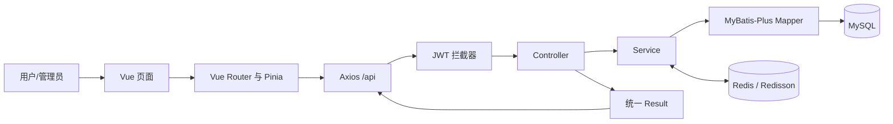

### 2.2 用户角色分析

#### 2.2.1 游客

游客尚未建立认证状态。注册、登录以及配置中显式放行的接口可以访问。当前项目的大部分 `/api/**` 请求受 JWT 拦截，专辑目录接口也需要按实际拦截配置理解为受保护接口。因此答辩演示前应先登录，而不能笼统声称所有商品浏览接口都支持匿名访问。

#### 2.2.2 普通用户

普通用户拥有个人资料、购物车、地址、订单、支付查询、退款申请和本人盲盒记录等权限。每次请求由后端从认证上下文取得用户 ID，对订单、地址、退款和抽取记录实施归属校验。客户端 URL 或请求体中的 ID 不代表调用者拥有该资源。

#### 2.2.3 管理员与超级管理员

管理员进入后台处理商品、订单、退款和审计业务。服务端对管理 API 校验管理员角色。部分高风险账号角色操作仅由超级管理员执行。前端隐藏菜单只改善体验，不能替代后端授权。

### 2.3 功能性需求

#### 2.3.1 用户管理

- 新用户能够注册；前端和后端均进行必填及格式校验。
- 用户能够使用用户名和密码登录，登录成功后获得真实 Token 和用户信息。
- 用户能够查看/修改本人资料及密码，不能通过传入其他用户 ID 修改他人资料。
- Token 失效后请求被拒绝，前端清理身份并引导重新登录。
- 注册成功后提示成功并跳转登录，不伪造已登录状态。

#### 2.3.2 商品浏览与歌曲

- 首页和商品页面展示后端返回的专辑信息，支持实际接口实现的搜索、筛选和分页。
- 专辑详情显示商品属性、价格、库存、封面及已关联曲目。
- 歌曲播放使用真实试听 URL；如果 URL 为空或资源失败，向用户显示明确提示。
- 数字内容访问需要验证本人订单和支付状态，不能将受限下载地址作为公开试听字段返回。

#### 2.3.3 地址与购物车

- 用户维护本人收货地址，包括查询、新增、修改、删除和默认地址管理。
- 用户查看、增减或移除本人购物车商品。
- 价格和库存由服务端重新读取，不信任前端计算结果。
- 当前购物车支持逐件结算，不宣称已有一键合并结算能力。

#### 2.3.4 订单、支付与履约

- 订单创建前校验用户、商品状态、价格、数量、库存及地址归属。
- 订单保存商品和收货信息快照，能够查询本人订单详情及物流。
- 开发演示使用模拟支付；模拟支付只推进本地状态，不发生真实资金交易。
- 未支付订单可取消或超时关闭并按服务流程回补库存。
- 管理员填写物流信息后，订单进入已发货；用户本人确认收货后进入已完成。

#### 2.3.5 退款

- 用户只能申请本人订单退款，服务端按订单状态和商品形态判断资格。
- 数字商品访问状态影响退款资格；实物已发货时需要相应退货物流资料。
- 管理员审核退款时检查权限和申请当前状态。
- 拒绝申请不应错误地改变支付、订单或库存状态。
- 真实渠道退款需要支付宝配置；模拟退款必须标明只改变本地测试状态。

#### 2.3.6 盲盒

- 用户浏览上架盲盒及奖品信息，选择允许的抽取次数和本人地址。
- 创建盲盒待支付订单时校验库存并预留购买数量。
- 未支付不产生中奖记录；支付成功后由服务端执行真实抽取逻辑。
- 抽取记录保存奖品、概率快照、序号和保底标识。
- 用户只能查询本人抽取记录；不能传入中奖奖品 ID 指定结果。

#### 2.3.7 管理后台

- 后台概览和资源页面调用实际存在的管理员接口。
- 专辑、歌曲、盲盒、用户、订单和审计日志操作必须与后端接口能力一致。
- 无后端删除接口时不得伪造删除成功。
- 重要后台操作应记录操作者、方法、路径、结果和时间等审计信息。

### 2.4 非功能性需求

#### 2.4.1 安全性

凭据和私钥不得写入源码或提交到 Git；受保护请求使用 JWT；后台 API 在后端检查角色；用户数据按身份隔离；上传媒体需限制类型与大小；日志不得包含 Token、密码或支付私钥。当前登录密码算法若为遗留摘要实现，应作为生产改造项，不可宣传为现代高强度口令存储方案。

#### 2.4.2 一致性与可靠性

订单、支付、退款、库存和抽奖使用事务、状态条件、Redisson 锁及数据库条件更新协同保护。支付通知可能重复到达，后端必须做到幂等。Redis 不能替代 MySQL 最终库存条件；事务也不能自动回滚已经完成的外部资金调用。

#### 2.4.3 可维护性

前端按页面、API、Store、布局和组件拆分。后端使用 Controller、DTO、Service、Mapper、Entity、VO 分层。接口文档、迁移脚本和测试用例随功能变化更新。

#### 2.4.4 可用性和响应式

页面提供加载、空数据、权限失败、网络异常和提交中状态。桌面端后台表格可用，手机端主要用户流程能操作；状态不能只靠颜色表示。性能指标需要在具体环境压测后确定，当前不虚构并发数字或响应时间承诺。

### 2.5 业务规则与约束

| 规则编号 | 规则 |
|---|---|
| BR-01 | 订单价格由后端按数据库商品价格计算 |
| BR-02 | 实物商品下单需验证地址属于当前用户 |
| BR-03 | 订单建立商品与地址快照 |
| BR-04 | 库存必须在条件满足后扣减，不能变为负数 |
| BR-05 | 订单只能按允许的状态机迁移 |
| BR-06 | 重复支付成功通知不能重复处理订单或重复抽奖 |
| BR-07 | 盲盒结果在支付成功后由后端产生 |
| BR-08 | 退款资格由后端综合商品形态、访问和订单状态判断 |
| BR-09 | 普通用户不能调用管理员操作 |
| BR-10 | 真实支付/退款与本地模拟状态必须区分 |

### 2.6 系统边界

系统内部负责账户、目录、交易和盲盒业务，持久化 MySQL 数据，使用 Redis/Redisson 辅助并发。支付平台、文件授权来源、短信/邮件、物流跟踪平台属于外部服务；当前项目没有证据时不能把这些接口描述成已完成集成。媒体上传使用项目本地 uploads 文件目录并由应用媒体路由访问，部署时需单独配置持久化和备份。

## 3 系统 UML 基本模型

### 3.1 用例图

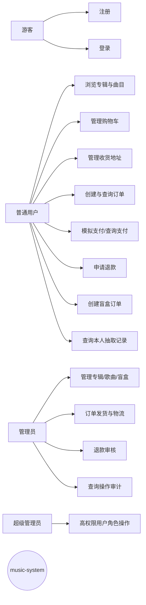

该用例图区分身份功能。盲盒用户用例是创建订单与查询结果，而不是前端直接调用抽奖。角色继承关系需按当前系统角色字段实现，若没有建模成 UML 泛化关系，也可在说明中用权限说明表达。

### 3.2 主要用例规约

#### 用例一：用户登录

| 项目 | 描述 |
|---|---|
| 主要参与者 | 普通用户/管理员 |
| 前置条件 | 账户已注册且可用，服务端可访问 |
| 触发条件 | 用户提交登录表单 |
| 主成功流程 | 前端校验 → 调用登录接口 → 后端验证凭据 → 签发 JWT → 返回用户资料 → Pinia 保存真实身份 |
| 异常流程 | 凭据错误、账户不可用、服务不可达时不建立登录态 |
| 后置条件 | 成功时后续 API 带 Bearer Token；失败时仍为未登录 |

#### 用例二：创建专辑订单

| 项目 | 描述 |
|---|---|
| 主要参与者 | 普通用户 |
| 前置条件 | 用户登录，商品有效，实物商品有有效本人地址 |
| 主成功流程 | 提交商品/数量/地址 → 服务端复核价格库存 → 锁与条件扣库存 → 保存订单与快照 → 返回待支付订单 |
| 异常流程 | 下架、库存不足、地址越权、参数非法或数据库异常时拒绝并补偿 |
| 后置条件 | 成功创建的订单可查询，库存变更可追溯 |

#### 用例三：购买盲盒并抽取

| 项目 | 描述 |
|---|---|
| 主要参与者 | 普通用户、订单服务、支付服务、盲盒服务 |
| 前置条件 | 登录、盲盒上架、库存充足、地址有效 |
| 主成功流程 | 前端创建待支付盲盒订单 → 预留库存 → 模拟支付 → 订单条件转为已支付 → 服务端抽取 → 保存记录/统计/摘要 → 页面查询记录 |
| 异常流程 | 未支付无结果；重复通知不重抽；抽取失败进入补偿路径 |
| 后置条件 | 每一抽均可在数据库追踪 |

#### 用例四：管理员发货

管理员登录后台，查询可发货订单，填写承运商与单号。后端校验角色、订单状态和物流字段，写入物流记录并推进订单状态，审计操作。用户随后只能确认自己的已发货订单。

#### 用例五：申请和审核退款

用户提交本人订单及原因，服务端检查商品形态、订单状态、数字访问记录、退货信息和重复申请。管理员审核后，拒绝只更新申请结果；批准时联动订单、支付及库存/渠道。真实渠道状态需要外部支付平台确认。

### 3.3 领域模型

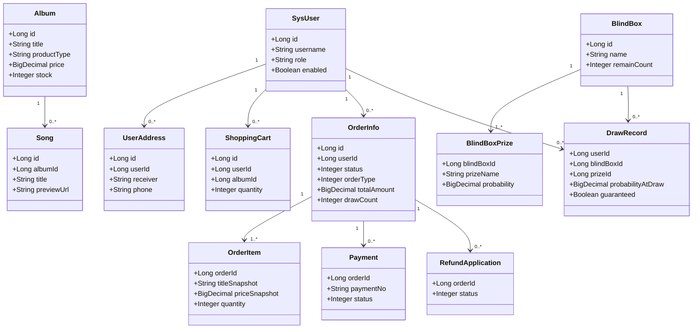

领域模型中的属性是帮助理解业务的示例字段，不替代数据库 DDL。实际字段名和可空性以 `sql/music_system.sql` 与迁移脚本为准。图中关系表达业务关联，是否存在物理外键必须查询真实 schema 后再说明。

### 3.4 实体职责说明

| 实体/聚合 | 职责 |
|---|---|
| 用户 | 身份、角色、账户状态；不允许向前端暴露密码摘要 |
| 专辑 | 商品展示、价格、形态、库存、上下架及数字内容配置 |
| 歌曲 | 与专辑关联的曲目信息和试听入口 |
| 地址 | 当前用户可维护的收货信息 |
| 订单主单 | 交易状态、金额、类型、地址快照、盲盒订单摘要 |
| 订单明细 | 下单时的商品快照和数量 |
| 支付单 | 支付渠道和支付状态，不等价于订单履约状态 |
| 退款申请 | 申请、审核和结果，关联支付与订单处理 |
| 盲盒奖池 | 奖品、等级和概率等抽取配置 |
| 抽取记录 | 一次抽取的结果与概率快照 |
| 库存流水 | 记录扣减、回补和相关业务来源 |
| 管理审计 | 记录重要管理操作的操作者和请求摘要 |

### 3.5 系统边界分析

系统内部负责用户认证、商品和订单业务规则、权限、抽奖、退款资格、数据库访问与本地媒体访问。外部边界包括 MySQL 服务、Redis 服务以及可选的支付宝服务。浏览器只通过 HTTP API 和静态/媒体资源访问应用，不直接连接数据库或 Redis。

付款通知可能由外部服务主动调用，因此回调接口的 JWT 例外不等于免验签；服务端还需校验支付渠道签名和交易信息。媒体 URL 可被浏览器直接访问，但数字内容下载须由后端检查订单权限。

## 4 基本动态建模

### 4.1 订单状态图

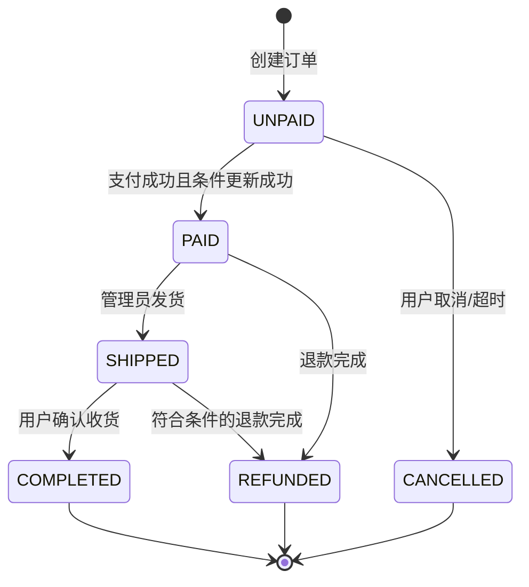

项目状态常量为待支付 0、已支付 1、已完成 2、已取消 3、已发货 4、已退款 5。图展示主要路径，不代表所有边缘状态都无需校验。Service 采用当前状态条件更新；非法迁移应拒绝。支付状态是 `payment` 中的独立状态，不应与订单状态混淆。

### 4.2 盲盒订单活动图

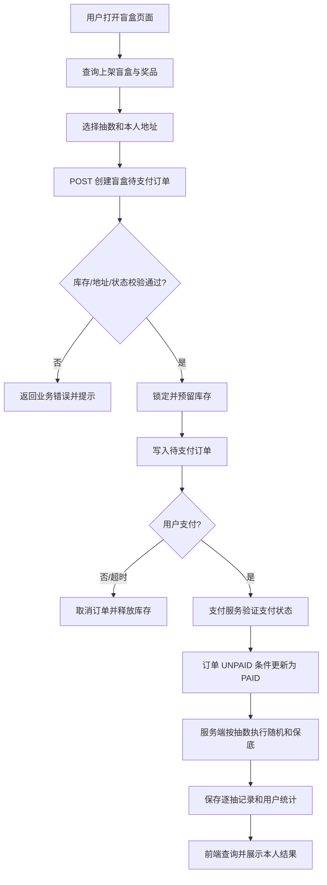

关键点是抽奖发生在支付成功链路。前端只有购买动作，没有决定奖品的逻辑。库存预扣在订单创建阶段完成，因此订单支付后的抽取路径不再扣第二次库存。

### 4.3 登录活动图

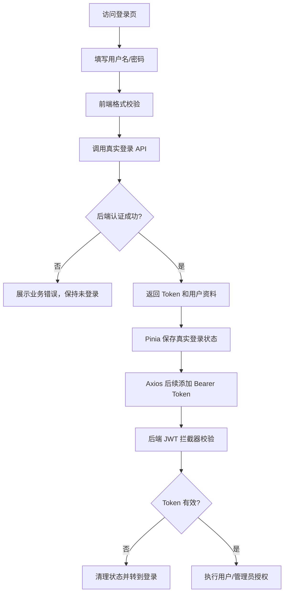

### 4.4 退款状态和活动

退款业务可用“申请记录状态”建模：用户提交后待审核，管理员拒绝则申请结束且订单支付保持原有状态；管理员批准后继续执行本地状态变更及渠道退款。实物已发货申请要补充退货物流信息；数字商品已被访问时按当前规则限制在线退款。外部渠道失败时，应保持可恢复状态，不可只在页面显示退款成功。

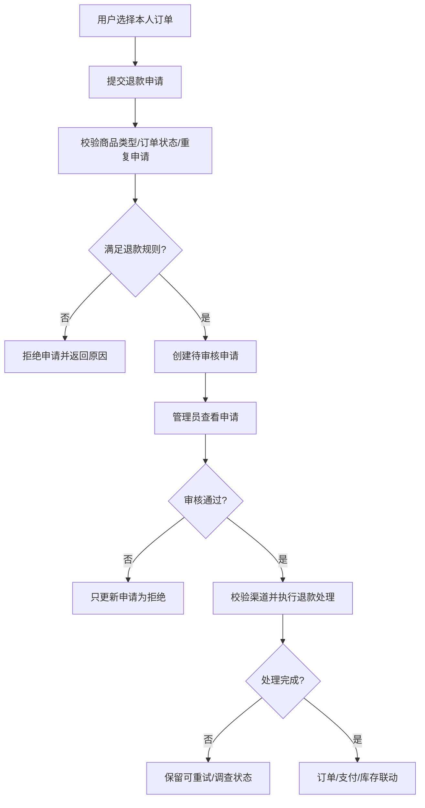

### 4.5 活动图说明

活动图中的菱形表示判断分支，事务、锁和持久化步骤都放在服务端泳道。浏览器表单只负责提交用户意图；最终金额、库存、权限和结果由后端重新校验。该分工避免用户直接修改页面数据绕过业务规则。

## 5 类的设计与实现

### 5.1 系统设计类

#### 5.1.1 前端类/模块

| 模块 | 文件/目录 | 责任 |
|---|---|---|
| 应用入口 | `frontend/src/main.js` | 创建 Vue 应用并安装 Router、Pinia 和样式 |
| 根组件 | `frontend/src/App.vue` | 挂载路由视图和全局播放器 |
| 路由 | `frontend/src/router/index.js` | 定义用户端/后台页面和路由守卫 |
| 用户状态 | `frontend/src/stores/user.js` | 保存真实登录响应和身份状态 |
| 请求封装 | `frontend/src/api/request.js` | Bearer Token、统一响应解包和错误处理 |
| API 模块 | `frontend/src/api/` | 按认证、商品、订单、盲盒、管理拆分请求 |
| 页面 | `frontend/src/views/` | 独立页面组件，承载页面交互 |
| 布局与组件 | `frontend/src/layouts/`、`components/` | 复用导航、管理侧栏、卡片和加载组件 |

#### 5.1.2 后端类

| 类/层 | 责任 |
|---|---|
| `MusicSystemApplication` | Spring Boot 应用入口 |
| Controller | 接收 HTTP 请求、DTO、认证上下文并返回 Result |
| DTO | 请求字段定义及参数校验 |
| Service 接口/实现 | 业务规则、事务、并发和状态处理 |
| Mapper | MyBatis-Plus 数据访问和自定义 SQL |
| Entity | 数据库实体映射 |
| VO | 面向前端的受控响应结构 |
| `JwtInterceptor` | 认证、请求上下文与相关审计处理 |
| `MyBatisPlusConfig` | 分页、驼峰映射、SQL 日志和时间填充配置 |
| `GlobalExceptionHandler` | 统一业务异常和参数异常响应 |
| `OrderTimeoutTask` | 定时处理过期未支付订单 |

### 5.2 类关系图

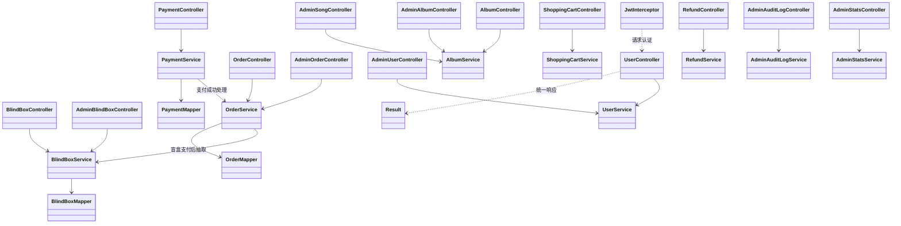

图表示逻辑依赖关系，不一定对应所有具体 Java 接口名。实际实现应以 `controller/`、`service/` 和 `mapper/` 包中的源码为准。

### 5.3 登录注册类

登录注册流程由用户 Controller、用户 Service、JWT 工具、用户 Mapper、前端登录页和 Pinia Store 共同完成。前端提供表单与格式校验；后端验证账号和密码，并签发令牌。前端只有收到服务端真实 Token 和用户资料后才更新登录状态。用户退出时清除 sessionStorage/Pinia，并导航到登录页。管理员不是独立的前端身份机制，而是登录后的角色属性，后台 API 仍在服务端校验。

### 5.4 商品管理类

商品管理由专辑和歌曲 Controller、对应 Service、Mapper 与实体组成。前端页面从真实接口获取列表和详情，通过管理 API 执行实际存在的新增/编辑/上传等操作。服务端校验必填字段、价格、库存和商品状态。数字商品内容访问和试听预览 URL 应分开控制。图片上传将文件放入 uploads，再保存 URL；系统不能仅因数据库记录有 URL 就认定文件已存在。

### 5.5 交易管理类

订单服务承载商品下单、快照、库存、取消、发货、确认收货等规则。支付服务管理支付单、模拟支付、渠道支付查询和支付成功回调；订单支付成功处理按订单当前状态幂等推进。退款服务和退款策略共同判断是否可申请，并协调订单、支付和库存。物流记录独立保存，以订单标识关联。

### 5.6 盲盒管理类

盲盒 Controller 提供目录、详情、订单购买及本人记录等用户接口；Service 完成订单创建和内部抽取。当前 Controller 没有用户直接抽奖的独立 HTTP 路由。支付成功由订单/支付服务调用 `drawForOrder`。抽取方法使用 SecureRandom 与奖品概率，维护用户的 SR/SSR 计数，并写逐次记录。服务层库存标志区分“创建订单预留库存”和“直接抽取扣库存”，支付后的订单抽取不能再次扣库存。

### 5.7 工具类与基础设施类

JWT 工具类负责签发和解析 Token；拦截器提取用户、角色并放入请求属性；MyBatis 配置提供分页、下划线转驼峰和自动时间填充；异常处理器转换错误响应；超时任务扫描过期订单。基础设施代码不应把业务规则转移到浏览器，也不应因方便调试而打印敏感值。

## 6 系统组件、分层与部署

### 6.1 系统包图

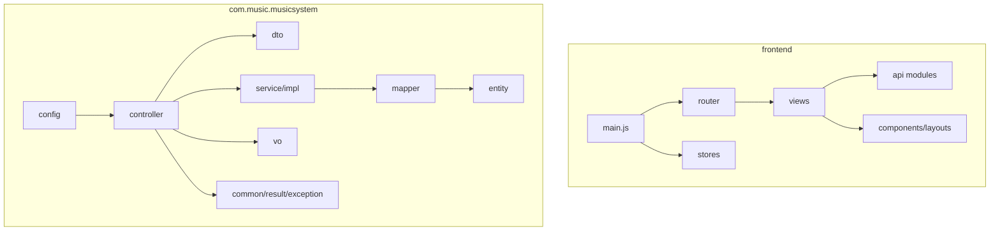

### 6.2 组件图

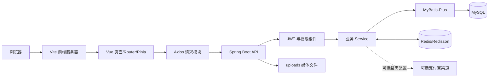

### 6.3 部署图

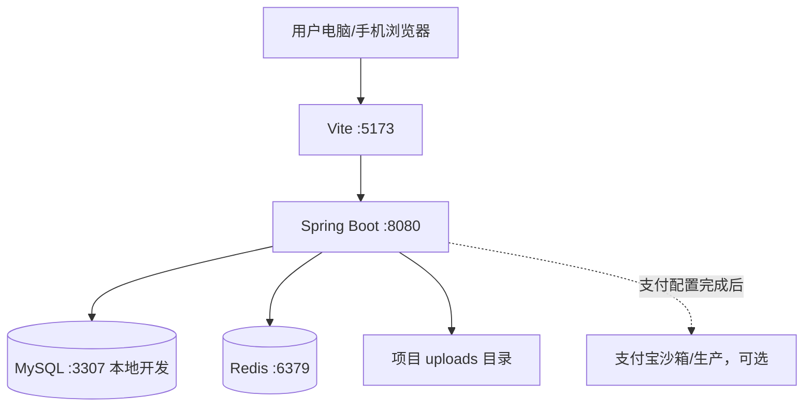

开发环境采用前后端分开启动。先确保 MySQL 与 Redis 正常，再启动后端，再启动 Vite。实际部署端口和拓扑需按环境设置，不能把本地配置直接当作生产配置。

### 6.4 关键运行依赖

| 依赖项 | 作用 | 缺失影响 |
|---|---|---|
| MySQL | 业务主数据、订单和流水持久化 | 主要页面和业务不可用 |
| Redis | 并发库存辅助和 Redisson 锁 | 并发控制路径可能无法运行 |
| JWT_SECRET | Token 签名/校验所需秘密 | 应用可能无法完成 JWT Bean 初始化 |
| uploads | 图片/媒体本地存储 | 上传或图片 URL 访问失败 |
| 支付配置 | 可选支付宝沙箱/真实通道 | 真实渠道不可用，可用模拟模式演示 |

### 6.5 数据库设计概要

核心表包括 `sys_user`、`album`、`song`、`shopping_cart`、`user_address`、`order_info`、`order_item`、`payment`、`order_logistics`、`refund_application`、`blind_box`、`blind_box_prize`、`draw_record`、`user_draw_stat`、`stock_log` 和 `admin_audit_log`。基础建表及迁移 SQL 位于 `sql/`。应用部署前应核对当前 schema 和迁移记录；不得在已有业务数据的数据库上随意重导初始化脚本。

## 7 软件项目管理

### 7.1 项目组织和角色

课程项目可由个人承担需求分析、前端开发、后端开发、数据库设计、测试和文档整理等职责。实际团队协作时建议职责分工如下：

| 角色 | 工作内容 | 产出 |
|---|---|---|
| 需求分析 | 角色、功能、边界、验收标准 | 需求规格与用例 |
| 前端开发 | Vue 页面、路由、API、响应式和交互 | 前端代码及浏览器结果 |
| 后端开发 | Controller/Service/Mapper、权限与业务 | Java 代码、接口和单测 |
| 数据维护 | schema、迁移、备份和一致性核验 | SQL、迁移记录 |
| 测试 | API、业务流程、权限、异常和 E2E | 测试报告及缺陷记录 |
| 项目负责人 | 范围、风险、进度、交付和答辩组织 | 计划、纪要和交付清单 |

### 7.2 工作分解结构 WBS

| WBS | 工作包 | 主要任务 | 验收产物 |
|---|---|---|---|
| 1.0 | 需求与范围 | 用户角色、核心流程、非功能需求、边界 | 需求说明书 |
| 2.0 | 架构设计 | 技术选型、分层、接口与数据模型 | 概要设计/UML |
| 3.0 | 后端基础 | 配置、统一响应、JWT、异常处理 | 可编译后端 |
| 4.0 | 用户及目录 | 注册登录、专辑、歌曲、个人资料 | 页面和 API |
| 5.0 | 用户交易 | 地址、购物车、订单、支付和物流 | 订单闭环 |
| 6.0 | 退款与盲盒 | 资格策略、审核、奖池、抽取与保底 | 记录可核验 |
| 7.0 | 管理后台 | 商品、用户、订单、审计 | 管理页面与权限 |
| 8.0 | 测试 | 编译、接口、集成、并发和浏览器 | 测试报告 |
| 9.0 | 交付 | 文档、运行说明、答辩排演 | 提交包 |

### 7.3 进度安排建议

本项目计划按依赖顺序安排，不虚构历史完成日期：

| 阶段 | 建议顺序 | 任务 | 进入下一阶段条件 |
|---|---:|---|---|
| 需求和 UML | 1 | 明确角色、用例、状态和边界 | 需求评审通过 |
| 架构与数据库 | 2 | 类图、组件图、表关系、迁移策略 | 模型可对应现有代码 |
| 后端基础 | 3 | 编译、配置、认证和统一响应 | 项目能正常启动 |
| 用户交易 | 4 | 地址、购物车、订单、模拟支付 | 核心订单可核验 |
| 盲盒与退款 | 5 | 支付后抽取、退款审批、补偿 | 状态和流水一致 |
| 前端验收 | 6 | 页面交互、权限、Playwright | 构建和主要用例通过 |
| 交付答辩 | 7 | 文档、风险说明和演示排练 | 结果与证据一致 |

### 7.4 进度跟踪方法

每项任务记录负责人、计划时间、当前状态、依赖、风险和验收证据。状态建议使用“未开始、进行中、待验证、已完成、受阻”。只有代码存在、接口验证、业务数据核对和文档更新均完成时才标记完成。构建通过不表示浏览器功能通过；页面点击成功不表示数据库写入正确。

### 7.5 变更管理

接口、数据库或业务规则变更前评估：影响页面、DTO、Service、表结构、迁移、兼容性、测试和现有数据。变更应通过代码审阅并更新文档。涉及数据库破坏性修改、现有用户角色、真实支付或用户文件时必须获得明确批准。不要使用 Git reset、clean 或强制覆盖来解决冲突。

## 8 测试与质量保证

### 8.1 测试层次

| 测试层级 | 目标 | 本项目示例 |
|---|---|---|
| 静态/编译 | 源码与依赖可编译 | Maven clean compile、npm build |
| 单元测试 | 小范围规则正确 | 订单状态、退款资格、保底边界 |
| 集成测试 | 多层真实协作 | Mapper、事务、库存和支付服务 |
| API 测试 | HTTP 契约正确 | 方法、路径、参数、响应和权限 |
| E2E 测试 | 浏览器真实流程 | 登录、下单、模拟支付、后台操作 |
| 运维验证 | 依赖服务和部署配置 | MySQL、Redis、端口、密钥、媒体路径 |

### 8.2 核心测试用例

| 编号 | 场景 | 预期结果 |
|---|---|---|
| T-01 | 注册重复用户名 | 后端拒绝，前端提示，不建立登录态 |
| T-02 | 正常登录与退出 | Token 真实保存，退出后访问被保护 API 失败 |
| T-03 | 普通用户访问管理 API | 服务端拒绝，数据库无管理写入 |
| T-04 | 用户访问他人订单/地址 | 后端按归属拒绝且不泄露内容 |
| T-05 | 库存不足下单 | 订单不成功，库存不为负数 |
| T-06 | 重复支付通知 | 订单只推进一次，盲盒不重复抽取 |
| T-07 | 已发货确认收货 | 只有本人、且当前状态正确时可完成 |
| T-08 | 数字商品访问后退款 | 按当前规则拒绝在线退款 |
| T-09 | 盲盒单抽/十连 | 支付后记录数量与订单抽数对应 |
| T-10 | 管理员发货 | 物流、状态和审计记录一致 |
| T-11 | 媒体上传失败 | 错误提示清楚，不伪报上传成功 |
| T-12 | 无效音源播放 | 显示无法播放，不显示虚假进度 |

### 8.3 测试数据安全

测试使用独立 QA 账号和带 QA 标记的数据。不得修改普通用户角色来制造管理员，不得清空共享数据库，不得执行真实支付。自动化测试如会留下订单、抽奖和退款数据，应记录留存。测试报告需要区分本次实际执行、历史结果、跳过和受阻项。

### 8.4 验收口径

验收应记录执行日期、环境版本、用户角色、请求路径/方法、HTTP 状态、业务码、页面结果和数据库只读核验。任何未执行的功能写“未测试”；依赖商户凭据或授权音源的项目写明外部条件。浏览器 Console 和 Network 错误要与后端日志一起分析。

## 9 风险、限制与改进方向

### 9.1 项目已知限制

1. 当前模拟支付只模拟本地支付状态，不是实际资金交易。
2. 真实支付宝验收依赖合法商户配置、密钥、回调和渠道确认。
3. 当前 10 首歌曲中，5 条试听 URL 为示例地址、5 条为空；已知真实可播放数量为 0/10。
4. 前端播放器交互存在不代表音频资源真实可用。
5. 首页/专辑目录接口当前受到 JWT 拦截，演示前需要登录。
6. 购物车当前逐件结算，不应把未实现的合并结算作为项目能力。
7. 部分后台能力是否完整需以 Controller 真实接口为准；无接口操作不能以静态按钮替代。
8. 单机本地运行不能证明生产级高可用、压测或灾备能力。

### 9.2 技术风险及应对

| 风险 | 影响 | 应对方案 |
|---|---|---|
| 8080 端口被占用 | 服务启动失败或请求打到旧进程 | 查 PID/命令行后再决定，不结束未知进程 |
| JWT 环境变量未被 IDE 读取 | 应用启动失败 | 安全配置用户环境变量后重启 IDEA |
| 数据库迁移未同步 | 启动或业务 SQL 失败 | 对照当前 schema 和迁移记录，备份后增量修复 |
| Redis 与 DB 库存差异 | 库存错乱风险 | 通过日志和流水定位，使用业务补偿，不清缓存猜测 |
| 重复支付回调 | 重复发货或抽奖 | 条件更新和幂等处理，并做重复通知测试 |
| 真实音源缺失 | 播放功能不能真实展示 | 使用授权音源并验收 URL/浏览器播放 |
| 支付配置缺失 | 无法验证真实资金渠道 | 使用模拟模式并明确非真实支付 |
| QA 数据污染演示 | 页面数据混杂 | 唯一 QA 标记和隔离测试库 |

### 9.3 改进方向

- 使用带随机盐的慢哈希密码方案，并规划兼容迁移。
- 将本地媒体存储迁移至受控对象存储，建立备份和访问策略。
- 增加支付/退款异步重试、对账和故障恢复机制。
- 增补订单、支付、库存、退款和盲盒的真实数据库集成测试。
- 建立独立测试 schema、CI 构建、Playwright 稳定化和覆盖率统计。
- 获得授权后补齐音频素材，区分试听与购买后数字内容访问。
- 完善生产 HTTPS、秘密管理、监控、备份恢复和并发容量评估。

## 10 总结与体会

本课程设计以实际音乐电商代码为对象，将需求分析、UML 建模和项目管理方法对应到正在运行的系统。通过用例建模，可以先明确游客、普通用户、管理员和超级管理员的职责，减少只从页面按钮推断功能的误区。通过领域模型和数据库关系梳理，可以看到商品、订单、支付、物流、退款和盲盒抽取记录之间的关联。

订单状态图帮助分析合法状态迁移，尤其是待支付订单的取消、支付成功、发货、确认收货和退款路径。盲盒活动图进一步说明，抽取不是前端随机展示，而是支付成功后由后端服务使用概率和保底规则执行。库存预留、支付幂等、事务和分布式锁分别解决不同问题，需要组合使用并通过测试验证。

项目管理方面，WBS、风险清单、质量门禁和变更管理能让项目状态更可追踪。课程报告也必须区分已经实现、部分实现、受阻和未测试。模拟支付、无效音频地址和生产配置缺失都应该如实披露。不能为了汇报效果将静态页面说成业务完成，也不能把编译通过当作真实业务验收。

后续工作应优先确保 QA 环境下用户交易、管理员履约、退款和盲盒支付后抽取稳定，并对订单、支付、库存和审计数据进行只读核验。获得授权的音源和支付沙箱条件后，再完成相应外部依赖验收。通过持续测试和文档更新，使项目最终达到可解释、可演示、可维护的课程设计交付标准。

## 参考资料

1. 项目源代码：`src/main/java/com/music/musicsystem/`。
2. 前端源代码：`frontend/src/`。
3. 数据库初始化与迁移：`sql/`。
4. 项目接口说明：`docs/接口文档.md`、`docs/前端接口文档.md`。
5. 项目运行和测试材料：`docs/后端启动说明.md`、`docs/前端启动说明.md`、`docs/全项目测试报告.md`、`docs/前端验收报告.md`。
6. 项目答辩复习材料：`docs/项目答辩复习讲解.md`。

## 附录 A 答辩演示顺序

1. 使用普通 QA 用户登录，说明 JWT 和个人数据隔离。
2. 浏览首页、专辑详情和曲目，指出页面数据来自真实 API；如展示播放器，说明当前无有效音源。
3. 展示地址和购物车，创建实物商品订单并解释服务端校验和快照。
4. 使用模拟支付，展示订单状态变化，说明不产生真实交易。
5. 切换 QA 管理员填写物流或审核退款，展示角色校验和审计。
6. 创建盲盒订单并模拟付款，展示服务端生成的逐抽结果及记录。
7. 展示数据库关系和测试报告，讲清项目限制与下一步工作。

## 附录 B Mermaid 图渲染说明

本报告中的 UML 与流程图以 Mermaid 源码保存。可在支持 Mermaid 的 Markdown 编辑器或课程允许的文档工具中渲染为图片，再插入 Word 版报告。渲染前应检查中文字体、图中文字大小、页面宽度和箭头方向。若提交系统只接受 Word/PDF，应将图表转换为清晰图片，并确保图片标题、编号和正文引用一致。
