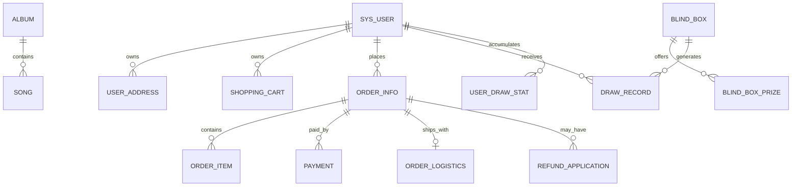

# 潮流音乐专辑及衍生品发售系统数据库说明文档

## 1 文档范围

本文说明 music-system 当前数据库的业务分组、主要表用途及关联关系。表名依据项目初始化 SQL 和日期迁移脚本整理；新增字段的最终定义应以目标数据库中已执行的脚本和实际结构为准。本文不包含数据库密码、用户凭据或可直接修改生产数据的语句。

## 2 数据库对象清单

| 表名 | 业务用途 | 主要关联 |
|---|---|---|
| `sys_user` | 用户账户、密码摘要、角色及账户状态 | 用户主表，关联购物车、地址、订单、抽奖记录 |
| `album` | 专辑/商品信息、商品形态、价格、库存、封面等 | 被 `song`、购物车及订单引用 |
| `song` | 专辑曲目与试听相关信息 | `song.album_id` 关联专辑 |
| `shopping_cart` | 用户购物车商品与数量 | 关联用户和专辑 |
| `user_address` | 用户收货地址及默认状态 | 被用户订单选择；订单另存地址快照 |
| `order_info` | 订单主记录、状态、金额、商品类型、地址快照及盲盒字段 | 关联用户、支付、物流、退款和订单明细 |
| `order_item` | 多商品订单的商品快照与数量 | 关联 `order_info` |
| `payment` | 支付流水、渠道、支付状态及交易编号 | 关联订单 |
| `order_logistics` | 承运商、物流单号和发货信息 | 关联订单 |
| `refund_application` | 退款申请、原因、审核人、状态及处理信息 | 关联订单和申请用户 |
| `blind_box` | 盲盒名称、价格、库存及上架状态 | 关联奖品、抽取记录和盲盒订单 |
| `blind_box_prize` | 盲盒奖品及概率、库存配置 | 关联盲盒 |
| `draw_record` | 每次抽取的用户、奖品、概率快照、序号及保底标识 | 关联用户、盲盒和奖品 |
| `user_draw_stat` | 用户抽取累计信息和保底计数 | 用户与盲盒维度统计 |
| `stock_log` | 商品库存变更流水 | 记录商品、变化数量及业务原因 |
| `admin_audit_log` | 管理员重要操作审计 | 保存操作者、请求及结果信息 |

部分基础结构或历史数据还涉及 `role`、`user_role` 等表，具体是否由当前版本使用应以 Mapper、迁移脚本和数据库实际结构核实，不能只因旧文档列出就推定当前登录使用该表。

## 3 核心关系

订单记录保存下单时的地址快照和商品明细快照，确保用户后来修改地址或管理员修改商品资料时，历史订单仍保留下单时的信息。盲盒订单通过订单类型及盲盒 ID、抽取次数等字段识别，不能仅根据专辑 ID 判断订单类别。

## 4 重要数据规则

### 4.1 商品形态

专辑商品区分数字商品和实物商品。实物交易依赖有效收货地址、物流和确认收货；数字商品需要验证本人订单及支付状态后才交付数字内容。数字内容访问记录参与退款资格判断。

### 4.2 订单状态

项目状态常量为：待支付 0、已支付 1、已完成 2、已取消 3、已发货 4、已退款 5。常见迁移为 `0→1→4→2`，未支付订单可 `0→3`，满足规则的订单可退款至 5。状态更新使用原状态条件，防止并发请求重复迁移。

### 4.3 支付状态

支付流水单独记录支付状态：待支付 0、成功 1、失败/关闭 2、已退款 3。支付记录用于支付流水追踪，订单状态用于商品履约，两者关联但不可混为同一个状态字段。

### 4.4 库存

下单库存和盲盒库存均由服务端校验。系统结合 Redis/Redisson 和数据库条件更新控制并发，并记录库存流水。取消或超时订单会经过服务端补偿流程恢复预留库存。排查库存问题时应同时核对数据库当前库存、库存流水和相关订单状态。

### 4.5 抽取记录

每次抽取单独写入 `draw_record`，保存抽取时的概率快照、奖品、序号和保底标识；用户累计抽数和保底计数放在 `user_draw_stat`；订单摘要放在订单相关字段。该设计支持结果追溯与保底状态延续。

## 5 初始化与迁移文件

- 基础建库/建表脚本：`sql/music_system.sql`
- 后续增量脚本：`sql/` 目录中按日期命名的迁移脚本，例如订单、物流、退款、审计、订单明细和图片字段相关脚本。
- `backup_music_system_20261023.sql` 是备份用途文件，不应当作普通增量迁移直接重复导入。
- `20261101_local_qa_admin_template.sql` 是 QA 管理员模板性质文件；执行前须确认影响范围和凭据生成方式。

## 6 数据安全与运维要求

1. 运行迁移前核对数据库名称、当前版本和脚本执行历史，并先备份目标数据。
2. 不要在已有业务库重复执行会重建对象或插入重复数据的初始化脚本。
3. 不执行未经授权的 `DROP`、`TRUNCATE` 或全表清理。
4. QA 数据应带清晰标记，便于区分演示记录；不要通过修改真实用户角色制造管理员。
5. 不把密码、JWT 密钥、支付私钥写入数据库文档或提交到版本库。
6. 连接数据库时使用最小权限账号；本地凭据通过安全的本地环境配置管理。

## 7 查询和核验建议

答辩或测试时，可只读核验以下关系：订单与用户/明细是否匹配；支付状态与订单状态是否同步；发货订单是否存在物流；退款状态与退款申请是否对应；盲盒支付订单是否存在对应数量的抽取记录；库存变化是否有库存流水。核验查询应限定测试用户或 QA 标记，避免输出其他用户的个人信息。

## 8 按业务域说明表结构

### 8.1 用户与权限域

`sys_user` 是用户身份和账户状态的核心表。其登录字段由认证代码实际读取，密码按项目现有摘要方式存储；说明文档不应记录明文密码。当前项目的管理员权限校验读取用户角色信息，答辩时应以 `JwtInterceptor`、管理员 Controller 和登录用户对象的真实角色字段为准。旧数据库材料中可能出现 `role`、`user_role` 等设计名，必须核对当前代码是否仍使用，不能将不同版本的模型混为一谈。

地址表按用户维度保存收件人、联系方式、行政区/详细地址和默认状态。地址是可变资料，因此订单创建时要复制收货信息，不能让历史订单通过地址表实时联查后被用户后续修改影响。用户查询地址必须带当前 userId 条件；设置默认地址时还要保证同一用户的默认地址规则一致。

### 8.2 商品和曲目域

`album` 保存商品展示和销售属性，包括商品形态、价格、库存、上下架及封面等字段；具体列名和允许值应查初始化脚本与迁移。数字商品和实物商品同属商品目录，但履约规则不同。`song` 保存曲目与专辑的关联及试听字段，专辑删除或隐藏时应考虑曲目列表的展示策略。音频文件或媒体二进制不应塞入关系表大字段，项目采用本地 uploads 文件和 URL 关联。

商品价格、封面和标题会随运营变化，订单明细要保存下单快照。库存是强一致业务字段，任何管理员手动改库存都应有审计或库存流水，避免数据库数值变化却找不到原因。

### 8.3 购物车域

`shopping_cart` 将用户和商品关联，并保存购买数量等选择状态。购物车属于临时意向数据，不是订单凭证。创建订单时必须以服务器商品状态为准重新校验价格和库存。用户修改/删除购物车项不能影响已经生成的订单快照；若存在逻辑删除，应检查它是否适用于该实体及 SQL 查询。

### 8.4 订单域

`order_info` 表示交易主单，保存用户、业务类型、金额、主状态、创建/过期时间，以及实物地址快照和盲盒扩展数据。`order_item` 用于保存每项商品的标题、封面、单价、数量、商品形态等下单快照。不能只查看旧式主表中的单个 `album_id` 来判断多商品订单内容。业务实现应维持订单主单与明细合计、金额和数量之间的一致。

### 8.5 支付与退款域

`payment` 记录支付尝试及支付状态，可能含支付单号、渠道、金额、渠道交易号等。敏感渠道响应不应不加过滤地全部保存或展示。一个订单可能在业务规则允许时经历支付单创建或关闭，因此排查问题要根据支付号、订单号和当前状态联合核对。

`refund_application` 保存申请人、订单、退款理由、审核人和结果等。申请记录与订单/支付是不同对象：申请被拒绝不代表订单退款；批准也必须确认渠道退款真实结果或明确处于模拟状态。任何数据库查询报告都应分清申请状态、订单状态和支付状态。

### 8.6 盲盒和抽取域

`blind_box` 是盲盒商品，`blind_box_prize` 是奖池条目；中奖结果在支付后写 `draw_record`。抽取记录存储抽取时概率快照，使日后修改奖池配置也不会改变历史记录的解释。`user_draw_stat` 保留用户累计次数及保底计数。维护这些表时必须确保统计值可以从抽取记录重建或复核，避免无依据地直接更新保底计数。

### 8.7 审计和库存流水域

`stock_log` 让人能够追溯库存增加、扣减和回补的来源；它与商品的当前库存形成“余额 + 流水”的核对关系。`admin_audit_log` 记录管理员关键请求，便于追踪后台操作。审计日志应限制查看权限，并避免写入 Authorization 头、密码或私钥等敏感字段。

## 9 字段类型和约束设计原则

以下为设计校验原则，不替代实际 SQL 中的字段定义：

| 字段类别 | 建议规则 | 验证方式 |
|---|---|---|
| 主键 | 使用项目统一主键类型并建立唯一约束 | 检查建表 DDL 和实体 `@TableId` |
| 外键关系 | 关联列类型一致；必要时增加索引 | 检查 Mapper 查询与迁移 DDL |
| 金额 | 使用定点数或最小货币单位整数，避免浮点误差 | 核对实体字段、Java 运算及 API 序列化 |
| 数量/库存 | 整数且不允许负值；更新时带足量条件 | 并发测试和边界 SQL 检查 |
| 状态 | 受控常量/枚举，变更需校验旧值 | 对照状态常量和更新 SQL |
| 概率 | 使用有精度的数值类型并限定合理范围 | 校验奖池总概率与抽取算法单位 |
| 时间 | 统一时区策略，数据库和应用避免混用本地时间 | 核对 JDBC 参数、Java 类型和配置 |
| URL | 存相对媒体地址或受控 URL，不存凭据 | 检查响应 VO 和前端请求 |
| 逻辑删除 | 只对目标实体启用逻辑删除 | 核对 `@TableLogic` 与全局配置 |

如需制定正式约束和索引，应先读取当前库的 `SHOW CREATE TABLE` 与迁移 DDL，不能仅从 Java 属性名推断数据库列长度或是否可空。

## 10 事务中的数据变更顺序

### 10.1 商品订单

建议按“校验用户和地址 → 读取/核验商品 → 锁定库存业务资源 → 条件扣减数据库库存 → 写库存流水 → 写订单主单和明细快照 → 提交事务”的顺序理解。实际实现中的 Redis 预扣和回补属于跨存储协调，不能假设 MySQL 回滚会自动回滚 Redis。出现异常时必须查看补偿分支和日志。

### 10.2 盲盒订单

创建待支付订单时先预留抽取次数对应的库存。未支付取消/超时会释放预留；支付成功再执行抽取，但不会再次扣同一批库存。抽取结果、用户统计、订单摘要应在数据库事务中形成可追溯关系。需测试“写入记录中途失败”时事务和补偿机制的表现。

### 10.3 退款

退款流程可能涉及本地 MySQL 与外部支付渠道。普通数据库事务不能回滚已成功的外部退款调用，因此若需要生产级可靠性，应采用明确的退款处理中状态、幂等外部请求、重试/对账机制或事务消息设计。当前代码能力应依据实际服务实现描述；不应在文档中宣称数据库事务可回滚第三方资金操作。

## 11 状态一致性核对清单

| 检查对象 | 核对条件 | 异常信号 |
|---|---|---|
| 订单与明细 | 明细商品/数量/金额与订单总额对应 | 主单有金额但无明细，或汇总不一致 |
| 订单与支付 | 支付成功对应订单已支付或后续有效状态 | 支付成功但订单仍待支付，需查通知处理 |
| 发货 | 已发货订单应有物流信息 | 状态已发货但无物流记录 |
| 退款 | 退款申请、支付和订单状态符合审核结果 | 申请拒绝但订单变退款，或支付已退订单未变 |
| 库存 | 当前库存与流水变化可解释 | 负库存、销量/库存不匹配、重复回补 |
| 盲盒抽取 | 成功支付订单的记录数与购买抽数一致 | 已支付无结果或重复结果 |
| 保底 | 统计数据与历史抽取可解释 | 计数负数、SSR 后未重置 |
| 用户归属 | 订单/地址/购物车属于当前 userId | 查询可读取其他用户记录 |

## 12 索引与查询性能建议

索引设计应围绕真实查询条件：用户订单列表通常按 userId 和创建时间过滤；抽取记录按 userId、盲盒和时间查询；后台订单按状态、时间及订单号筛选；审计按操作者、路径、时间筛选。创建索引前检查现有索引和数据规模，避免重复索引增加写入成本。分页查询需要稳定排序，避免翻页期间同一数据重复或遗漏。大偏移量分页可在数据量增长后评估游标方案。

外键约束、唯一约束和索引需要结合现有数据清理情况谨慎引入。迁移执行前检查重复值和孤儿记录；若已有脏数据，应准备审计和修复方案而不是让生产迁移意外失败。

## 13 迁移脚本管理

每个迁移脚本应包含日期/版本、目标对象、变更目的、前置条件、执行步骤、验证查询及回滚或补偿说明。脚本应可审阅，尽量幂等；不能保证重复执行安全时，必须在脚本头部明确“仅执行一次”。部署流水线应记录已执行版本，避免凭文件名猜测是否执行过。

操作流程：

1. 确认服务器和数据库名，验证当前版本和备份可恢复性。
2. 检查迁移差异，确认只会新增或调整预期对象。
3. 在隔离副本执行，检查行数、索引和业务查询。
4. 维护窗口内执行目标迁移，记录时间和脚本版本。
5. 执行只读验证，核对表、字段和现有数据没有丢失。
6. 若出错先停止后续脚本，依据备份和回滚方案处理，不直接清库重建。

## 14 备份、恢复与隐私

备份至少覆盖 MySQL 逻辑/物理数据、uploads 文件、部署配置模板和迁移版本；密钥应通过单独的秘密管理机制备份，不与普通代码仓库混放。备份文件应加密、限定访问权限并定期进行恢复演练。恢复应先到隔离环境验证，避免把旧数据覆盖到当前数据库。

导出测试数据时应优先使用 QA 用户和合成订单。身份证明、联系方式、密码摘要和支付字段属于敏感数据，应最小化访问和展示。截图或答辩演示需遮挡用户名以外的私人信息，禁止展示 Token 和 Authorization 请求头。

## 15 只读排障步骤

1. 先记录问题发生时间、QA 测试账号、订单号或业务标识。
2. 只读查询订单主单、明细、支付、物流/退款或抽取相关记录。
3. 对照服务日志与审计日志，确认请求是否到达、是否通过权限检查。
4. 对库存类问题对照当前库存与 `stock_log`，不要先手工改数字。
5. 对重复支付问题检查支付单状态、订单状态条件更新结果和是否重复抽取。
6. 明确数据差异后再设计经批准的修正脚本，并先备份受影响字段。

排障查询不得输出用户密码摘要、JWT、支付私钥或完整个人地址。需要共享问题证据时使用测试数据并遮盖敏感字段。

## 16 数据库验收用例

| 编号 | 场景 | 只读/测试动作 | 预期 |
|---|---|---|---|
| DB-01 | 用户与地址隔离 | 用两个 QA 账号分别查看地址 | 只能读取本人地址 |
| DB-02 | 订单快照 | 创建订单后改变目录测试数据 | 原订单快照保持原值 |
| DB-03 | 库存扣减 | 购买后查看商品与库存流水 | 数量与业务变化相符 |
| DB-04 | 取消回补 | 取消待支付 QA 订单 | 库存恢复且流水可追溯 |
| DB-05 | 支付幂等 | 对同一测试支付重试通知 | 订单只推进一次 |
| DB-06 | 盲盒记录 | 支付单抽/十连 QA 订单 | 记录数量和订单抽数匹配 |
| DB-07 | 退款审核 | 对可退款 QA 订单审核 | 申请、支付和订单状态匹配 |
| DB-08 | 审计 | 执行一次授权管理操作 | 能按操作者/时间查到记录 |
| DB-09 | 迁移 | 在备份副本运行增量 SQL | 对象存在且旧数据保留 |

## 17 常见误区

- 订单行存在不代表支付成功；必须核对支付流水及状态。
- 退款申请存在不代表钱已退回；要看审核和渠道处理状态。
- Redis 中有库存 key 不代表数据库库存正确；必须核对 MySQL 和流水。
- 盲盒奖品概率变化不应重写历史概率快照。
- 逻辑删除不是物理删除，也不适用于未配置该字段的所有表。
- SQL 初始化文件、备份和增量迁移用途不同，不得互相替代。
- 旧数据库设计说明只提供参考，最终以当前项目迁移和实际结构为准。

## 18 答辩数据库讲解建议

可以按“用户与商品 → 订单及明细快照 → 支付与物流/退款 → 盲盒奖池与结果 → 库存及审计”顺序说明。重点讲解订单为什么要保存地址和商品快照、为什么支付流水与订单状态分开、为什么盲盒概率要保存抽取时快照、为什么使用库存流水。演示时只查看 QA 数据，使用只读 SQL，不现场执行迁移或更新生产记录。

## 19 逻辑数据字典

本节按业务含义说明字段组，不代替数据库的精确 DDL。实际列名、长度、是否可空、默认值和索引，应使用当前部署库的表结构结果确认。

### 19.1 用户表字段组

用户表逻辑上包含主键、登录名、密码摘要、展示资料、角色或权限来源、启用状态和创建更新时间。登录名需要唯一性保障；密码摘要不能在查询 VO 或日志中返回。若当前角色直接存于用户字段，则以该字段为授权来源；若使用关联表，则必须追踪登录聚合过程。不得将旧文档中学习平台 `user_role` 设计直接视为当前项目结构。

### 19.2 商品表字段组

专辑实体通常分为身份信息、展示信息、销售属性、库存销售统计、上下架状态、商品形态、数字内容访问配置及时间字段。字段组合应满足：下架商品不可新下单；库存扣减不能为负；数字内容地址不能因公开目录查询而泄漏；封面 URL 必须与媒体服务可达路径匹配。实体注解和迁移脚本需一并检查。

### 19.3 订单表字段组

订单主表包括订单标识、用户标识、业务类型、状态、总金额、过期时间、地址快照、盲盒订单扩展信息和状态时间戳。订单标识面向用户展示时应避免可枚举带来的越权风险，后端仍必须进行 userId 校验。订单金额需要与明细总额一致；盲盒订单的抽数和盲盒 ID 应与抽取记录关联。

### 19.4 抽取记录字段组

抽取记录需能说明谁在何时对哪个盲盒进行了第几次抽取，命中了哪个奖品、当时的概率是多少、是否通过保底取得。若只保存奖品 ID 而没有概率快照，奖池调整后无法还原当时规则；若只保存订单摘要而无逐抽明细，也无法核验十连抽中的每次结果。

## 20 表间数据生命周期

### 20.1 用户生命周期

账户创建后可关联地址、购物车、订单、退款和抽取记录。停用用户不应因此删除历史交易；订单和审计记录需要保留可追溯的主体标识。密码修改不应改变订单等其他业务数据。注销/数据删除需求需先明确法律与审计保留要求，目前不能通过直接删除用户行实现。

### 20.2 商品生命周期

商品从创建、编辑、上架、售罄或下架进入历史状态。物理删除商品会破坏订单快照之外的关联查询和歌曲关系，因此优先使用业务状态或逻辑删除策略。运营修改价格和封面时，历史订单的快照应保持；现有数据是否包含快照取决于迁移版本，需核对目标环境。

### 20.3 订单生命周期

订单由待支付进入已支付，再进入已发货、已完成或退款状态；未支付订单可取消或超时。支付单、退款申请和物流记录以订单为根关联。订单关闭后是否允许再次购买是创建新订单的业务，不应复用旧订单状态。所有状态更新应检查原状态和操作者身份。

### 20.4 盲盒生命周期

盲盒维护奖池并产生订单。订单预留库存，支付成功产生抽取记录，取消或失败执行释放/补偿。奖池条目停售不应删除历史结果所引用的信息；如果保留奖品 ID 已不够解释历史，应在抽取记录留存奖品名称/等级快照或保证奖品记录长期保留。

## 21 数据库状态与应用状态映射

| 应用对象 | 数据来源 | 适合返回前端的内容 | 不适合直接返回的内容 |
|---|---|---|---|
| 用户资料 | `sys_user` 及角色信息 | 当前用户可见资料、显示角色 | 密码摘要、内部安全字段 |
| 商品详情 | `album`、关联 `song` | 名称、封面、价格、上架状态、公开试听 | 未授权的数字内容下载地址、内部风控信息 |
| 订单详情 | `order_info`、`order_item` | 本人订单状态、商品/地址快照、物流 | 他人订单、内部支付凭证和秘密字段 |
| 支付结果 | `payment` | 用户可见支付号及状态 | 私钥、完整渠道签名数据 |
| 退款详情 | `refund_application` | 本人申请状态与可展示原因 | 管理内部敏感备注、他人申请 |
| 抽奖记录 | `draw_record`、统计表 | 本人奖品、抽取日期、等级 | 其他用户隐私、可利用的内部密钥 |
| 审计记录 | `admin_audit_log` | 授权管理员按条件查询的操作摘要 | 未授权用户的操作者隐私 |

数据实体到 VO 的映射是安全边界的一部分。将数据库实体直接序列化可能暴露未来新增的内部字段，因此优先使用明确的 VO 输出。

## 22 逻辑删除与物理清理

逻辑删除通过标记字段让业务查询默认忽略记录，便于误操作恢复和历史追溯；物理删除会不可逆地移除数据。系统中可能只有部分实体配置 `@TableLogic`，不能据此认为所有删除接口都执行逻辑删除。删除商品或奖品前要检查订单、抽取记录和图片引用，实际业务可以采用下架或禁用替代删除。

需要清理 QA 数据时，应采用明确标记、受限条件和经过复核的清理脚本；当前默认策略是保留 QA 记录，既便于复现，也避免误删真实数据。执行任何清理操作之前必须列出将受影响的记录数与主键，并获得授权。

## 23 时间、金额、字符集和序列化

### 23.1 时间

应用、数据库和 JDBC URL 必须采用一致的时区解释。时间范围查询通常按左闭右开方式构造，避免毫秒精度边界遗漏。日志时间和业务表时间应能关联定位。排障时优先用统一时区的时间戳，不直接比较不同工具按本地时区格式化的字符串。

### 23.2 金额

货币金额应使用精确小数或最小货币单位整数；Java `double` 不适合累计金额。订单总额、明细单价、数量与退款金额要在服务端按规则计算，客户端的显示值不能作为结算事实。数据库字段精度需能容纳项目允许的金额范围。

### 23.3 字符集

MySQL 数据库、表、连接 URL 和应用统一使用 UTF-8 系列字符集，保证中文商品名、地址和备注可往返保存。出现乱码时检查连接编码、表字符集和客户端渲染，不应通过删除乱码数据修复。迁移脚本应使用正确 UTF-8 编码并在导入前检查文件内容。

### 23.4 JSON/枚举

状态码和商品形态在数据库中的存储格式应与 Java 常量以及 API VO 映射保持一致。客户端可显示中文标签，但不能提交不受支持的标签文本作为状态值。盲盒结果摘要若以 JSON 保存，应设置稳定结构、做好反序列化容错，并以逐条抽取表作为可审计事实来源。

## 24 约束校验清单

| 校验项 | 检查方式 | 失败后处理原则 |
|---|---|---|
| 主键唯一 | DDL 主键/唯一索引 | 不通过应用端随机重试掩盖重复数据 |
| 用户名唯一 | 唯一索引及重复注册测试 | 返回明确冲突业务错误 |
| 订单编号唯一 | 唯一索引和并发创建测试 | 生成器冲突时安全失败/重试 |
| 数量为正 | DTO 校验 + 数据库约束 | 拒绝，不写订单和库存流水 |
| 库存非负 | 条件更新或检查约束 | 并发失败时回滚/补偿 |
| 地址归属 | SQL 条件包含 user_id | 拒绝越权，不返回地址内容 |
| 订单归属 | 查询条件包含 user_id | 统一拒绝，不泄漏订单存在性 |
| 抽取数量匹配 | 订单 draw_count 对照记录 | 调查支付幂等和事务日志 |
| 退款重复 | 唯一业务规则/状态查询 | 返回已有申请状态 |
| 审计完整 | 操作后查询审计 | 评估日志失败策略和告警 |

## 25 数据库测试环境设计

自动化测试需要隔离数据源，不应默认连接日常使用的库。可以使用独立测试数据库或带 QA 前缀/标志的数据集；测试脚本必须明确是否会保留创建的记录。并发测试应限制规模并在可恢复的环境运行，避免对正式库产生压力。测试初始化只插入所需 QA 数据，清理操作限于测试 schema 或具备明确唯一标记的记录，不得对共享库执行全表清空。

测试数据建议包含：正常上架商品、库存不足商品、数字内容商品、实物商品、启用盲盒及奖池；账户至少包含普通用户与经批准创建的 QA 管理员。管理员账号由本地安全说明获取，不把密码硬编码进 SQL 或脚本。

## 26 SQL 变更审查规范

代码审查迁移脚本时应检查：

1. 是否只作用于预期 schema 和对象。
2. 是否包含无条件删除、全表更新或大范围回填。
3. 是否会锁表或长时间重建大表。
4. 是否兼容当前应用版本和 MySQL 8.x 语法。
5. 是否有重复执行保护或明确一次性说明。
6. 新约束是否会被现有脏数据违反。
7. 默认值是否会让历史记录产生错误语义。
8. 回滚是否会丢失新写入数据。
9. 执行后如何只读验证。
10. 是否需要同步修改 Entity、DTO、Mapper、VO 和测试。

## 27 数据库故障响应流程

遇到连接失败先确认服务监听、地址、端口和数据库名；不要先改密码或重装。遇到表/列不存在时，核对迁移版本和当前 schema，确认是漏执行迁移还是启动了错误数据库。遇到字段乱码时，检查连接字符集和列定义，先用 QA 数据做读写往返测试。遇到订单数据不一致时，保留问题订单号、审计/应用日志和只读查询结果，不直接手工修复。需要修复时准备受影响记录清单、备份及可审核 SQL。

## 28 数据保留与容量建议

订单、支付、退款和审计数据的保留期应由课程要求、部署环境和适用法规决定；本项目没有在文档中虚构法定保留年限。大图和音频放在文件存储，不放入 MySQL BLOB；数据库仅存必要 URL 和元数据。历史日志增长后可按经批准的归档策略处理，但不能删除仍用于交易追溯的流水。备份存储容量应计算数据库和媒体文件总量，并定期验证恢复时间。

## 29 审计追溯示例

若管理员发货后用户反馈订单未更新，可按订单号找到订单主记录和物流记录，再按操作者、请求路径和时间查管理审计，最后查看应用日志是否记录条件更新失败。若盲盒支付完成但用户没看到奖品，先查支付记录与订单状态，然后查订单抽数、draw_record 条数和抽取异常日志。若库存显示异常，查订单取消/支付事件及 stock_log，而不是直接将库存字段改回某个猜测数。

## 30 最终交付核对表

- [ ] 已根据当前数据库输出确认表名和列定义。
- [ ] 每个日期迁移脚本均有执行状态记录。
- [ ] 主键、唯一约束、条件更新和索引符合当前查询。
- [ ] QA 数据和真实用户数据可区分。
- [ ] 订单、支付、退款和物流状态可以相互追踪。
- [ ] 库存日志与实际扣减/回补相对应。
- [ ] 盲盒概率快照和抽取结果可以审计。
- [ ] 媒体 URL 对应可访问文件，备份包含 uploads。
- [ ] 说明和截图没有泄露密码或个人信息。
- [ ] 数据库备份已执行恢复验证或标记未验证。

## 31 主要查询场景设计

| 查询场景 | 过滤条件 | 排序/分页 | 安全要求 |
|---|---|---|---|
| 用户订单列表 | 当前认证用户 ID、可选状态 | 创建时间倒序、分页 | userId 不接受客户端替换 |
| 后台订单检索 | 管理员权限、状态/编号/时间 | 创建时间倒序、分页 | 管理角色校验、限制敏感字段 |
| 用户地址列表 | 当前用户 ID | 默认地址/更新时间 | 不允许跨用户查询 |
| 用户退款记录 | 当前用户 ID | 申请时间倒序 | 不暴露其他用户申请 |
| 盲盒抽取记录 | 当前用户 ID、盲盒 ID | 抽取时间倒序、分页 | 记录归属必须服务端过滤 |
| 后台审计查询 | 管理员权限、操作者/路径/时间 | 操作时间倒序、分页 | 审计查询本身不可匿名 |
| 库存流水核查 | 商品 ID、业务关联标识 | 发生时间倒序 | 仅运营授权人员查看 |

分页查询要限制 pageSize 上限，避免客户端请求超大页导致数据库压力。排序字段应来自白名单，不直接把客户端任意字符串拼入 SQL。查询日志应避免输出完整个人信息。

## 32 数据完整性示例

### 32.1 订单金额

创建订单时服务端按数据库中的商品价格乘数量计算行金额，再按业务规则汇总为订单金额。若有运费、优惠或税费，应由明确字段和规则表示；未实现的费用项不能用前端临时计算加入总额。退款金额不能超过实际可退金额，并应与订单类型和渠道状态一致。

### 32.2 库存流水

每笔库存变化应能说明来源：用户下单扣减、未支付取消回补、退款回补或管理员库存调整。流水至少应通过业务关联 ID 找到订单或管理操作。查询当前库存时，应将历史流水和初始库存/盘点基线结合，不能简单对所有历史变化求和而忽略迁移与人工盘点。

### 32.3 抽取和保底统计

每个付费抽取机会对应一次奖品结果。订单购买十次应产生十条逐抽记录，除非业务明确存在失败补偿记录。保底计数是运行状态，抽取记录是审计事实；如果两者不一致，应通过规则重建和人工确认处理，不直接覆盖统计字段。奖品概率快照要保留足够精度以解释抽取结果。

## 33 数据库访问性能检查步骤

1. 从页面 Network 找到高频或耗时接口，记录实际筛选参数。
2. 在 Mapper 中定位对应 SQL，并确认是否有分页和稳定排序。
3. 对照 `EXPLAIN` 计划检查索引使用；执行前确保只读分析环境。
4. 统计返回行数和响应大小，检查是否返回了页面不需要的字段。
5. 若增加索引，评估写入开销、重复索引和迁移锁表风险。
6. 用代表性 QA 数据进行测量，避免只用空表得出性能结论。
7. 记录硬件、数据量、并发和测试时间，不泛化为无条件性能承诺。

## 34 Schema 差异说明

项目同时包含基础 SQL 和多个日期迁移文件，因此“仓库里有某列”不能证明目标数据库已经执行该迁移。检查环境时应组合使用：

- 实际 schema 的 `SHOW CREATE TABLE` 输出；
- 已执行迁移的版本记录或部署记录；
- Java Entity 与 Mapper 字段映射；
- 初始化/迁移 SQL 的定义和变更条件；
- 运行时 ORM/SQL 报错。

发现差异时先确定目标库和应用启动配置，排除连接到了不同实例。未经确认不能直接对当前库执行迁移，也不能用本地初始化 SQL 覆盖现有结构。

## 35 逻辑关联不等于数据库外键

本文图示中的关系是业务逻辑关联，是否配置物理外键需要检查 DDL。有些系统使用应用层校验而不设置数据库外键，可能出于迁移和历史数据原因。报告不能仅凭 Mapper 使用关联 ID 就声称数据库已建立外键。若要引入外键，应先核对孤儿数据、删除策略和级联行为，避免意外级联删除历史订单或记录。

## 36 重要字段的展示脱敏

| 字段类别 | 后台是否可见 | 普通用户是否可见 | 日志处理 |
|---|---|---|---|
| 登录用户名 | 按管理权限 | 本人/公开昵称 | 可记录必要标识，避免无关扩散 |
| 密码摘要 | 不应展示 | 不可见 | 禁止记录 |
| JWT/Authorization | 不可展示 | 不可见 | 禁止记录 |
| 收货电话/详细地址 | 业务履约需要时最小展示 | 仅本人订单/地址 | 遮盖或限制访问 |
| 支付私钥/签名秘密 | 不可展示 | 不可见 | 禁止记录 |
| 支付单号/渠道交易号 | 按业务需要部分展示 | 本人订单可展示必要部分 | 按权限限制 |
| IP 地址 | 审计用途按权限查看 | 不面向普通用户 | 限定保留和访问 |

## 37 答辩数据库演示脚本

1. 先展示 ER 关系图，说明用户、商品、订单和支付之间的关系。
2. 使用只读查询限定 QA 用户，展示一笔待支付订单的主单和明细。
3. 通过模拟支付后刷新查询，解释支付单和订单状态分别发生了什么变化。
4. 对实物订单查看地址快照和物流记录，说明用户地址变更不覆盖订单历史。
5. 对盲盒订单查看抽数、逐条记录、概率快照和用户保底计数。
6. 对管理员操作查看审计记录，并说明普通用户无权查询。
7. 展示库存流水而不直接更新库存字段。

现场演示只读取 QA 记录；展示前应遮蔽姓名、电话、详细地址、密钥和 Token。若某条记录不存在，不应临时插入未经评估的业务数据来掩盖问题。
