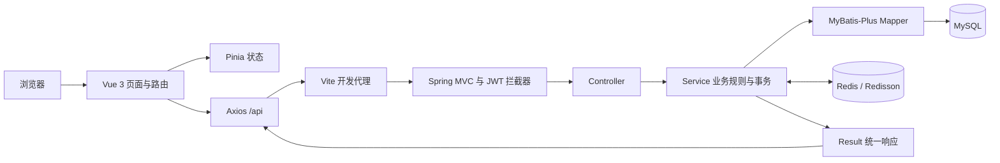
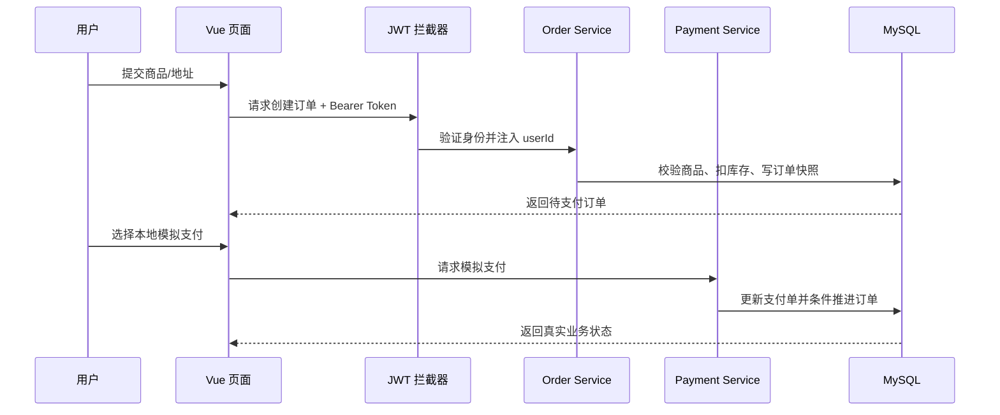
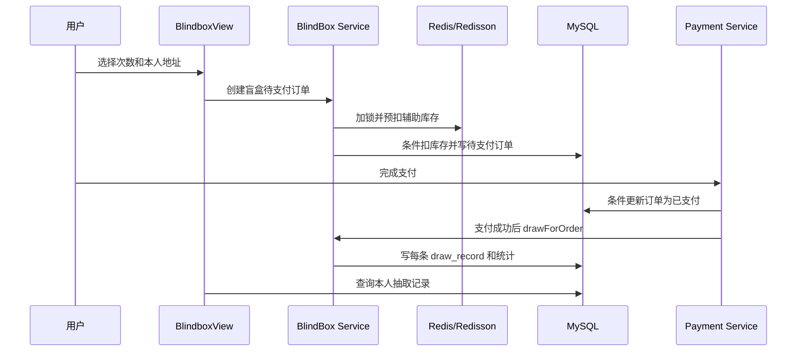

# 潮流音乐专辑及衍生品发售系统概要设计说明书

## 1 设计目标

本文概述 music-system 的架构、模块划分、关键业务设计和安全策略，便于开发维护及项目答辩。系统将展示交互放在 Vue 前端，将身份校验、交易规则、库存及抽取结果放在 Spring Boot 后端，MySQL 作为业务数据的持久化依据，Redis/Redisson 支持库存并发控制。

## 2 总体架构

生产或部署环境中，前端静态资源和后端服务可分别部署；当前本地开发使用 Vite 5173，通过代理访问后端 8080。

## 3 技术选型

| 子系统 | 技术 | 职责 |
|---|---|---|
| 前端 | Vue 3、JavaScript、Vite | 页面、表单、商品展示及交互 |
| 路由和状态 | Vue Router、Pinia | 页面导航、登录信息和播放器状态 |
| 请求与组件 | Axios、Element Plus | 统一 API 调用、表单/表格/消息提示 |
| 后端 | Java 17、Spring Boot 4.0.8 | HTTP 接口、依赖管理、业务入口 |
| ORM | MyBatis-Plus 3.5.17 | 实体映射、分页和数据库访问 |
| 缓存锁 | Redis、Redisson 3.35.0 | 库存辅助计数及分布式互斥 |
| 数据库 | MySQL 8.x | 用户、商品、订单及审计等数据 |
| 认证 | JJWT 0.12.6 | 令牌签发、校验和过期控制 |

## 4 前端模块设计

- `frontend/src/main.js` 创建 Vue 应用并挂载 Pinia、Router 和全局样式。
- `frontend/src/router/index.js` 定义用户端与管理员路由；登录与管理员守卫改善使用体验。
- `frontend/src/stores/user.js` 保存服务端确认的 Token 与用户资料；登录状态使用 sessionStorage。
- `frontend/src/api/request.js` 统一设置 `/api` 前缀、携带 Bearer Token、解析业务响应并处理 401。
- `frontend/src/api/` 按用户、专辑、购物车、订单、支付、退款、盲盒和管理接口划分。
- `frontend/src/layouts/`、`components/`、`views/` 分别承载布局、复用组件与独立页面。
- 管理页面隐藏菜单不构成权限边界；所有管理请求仍由后端鉴权。

## 5 后端模块设计

| 层 | 主要职责 |
|---|---|
| Controller | 绑定 HTTP 方法、路径、参数及当前用户上下文，返回统一 Result |
| DTO / VO | 分别承载输入校验对象和输出展示对象 |
| Service | 实现订单、库存、支付、退款、抽奖等规则和事务边界 |
| Mapper | 执行 MyBatis-Plus 或自定义 SQL 数据访问 |
| Entity | 对应业务表和持久化字段 |
| Interceptor / Config | JWT 认证、权限入口、审计、MyBatis 配置等 |
| Exception Handler | 将业务异常和校验异常转换为统一 API 响应 |

应用路径主要在 `src/main/java/com/music/musicsystem/` 下的 `controller`、`service`、`mapper`、`entity`、`dto`、`vo`、`config` 和 `common` 包中。

## 6 核心业务设计

### 6.1 认证和权限

用户登录成功后由后端签发 JWT。前端通过 Axios 拦截器携带 Token；后端 `JwtInterceptor` 校验签名与有效期，并将用户标识和角色放入请求上下文。Controller/Service 对数据所有权及管理员权限再次校验。未登录、普通用户或权限不足时应由服务端拒绝。

### 6.2 专辑订单

创建订单前校验商品状态、价格、数量、库存及收货地址归属。对实物商品记录收货信息快照；订单明细记录下单时的商品名称、封面、单价、数量及形态。库存通过 Redisson 锁、Redis 辅助扣减和 MySQL 条件更新协同保护，并保存库存流水。取消/超时会走对应回补流程。

### 6.3 状态管理和支付幂等

订单状态由后端按允许的迁移推进：待支付、已支付、已发货、已完成、已取消、已退款。更新语句以原状态作为条件；支付成功只允许待支付订单推进为已支付，重复通知不会再次触发状态推进。支付流水与履约订单分开存储。

### 6.4 盲盒支付后抽取

前端创建盲盒订单时只提交盲盒 ID、抽取次数和地址 ID，不产生中奖结果。后端检查次数、上架状态、库存及地址归属，对库存预留并生成待支付订单。支付成功处理识别盲盒订单后调用 `drawForOrder`；抽奖在后端使用 `SecureRandom` 和配置概率，并应用 SR/SSR 保底，逐次写入抽取记录、更新用户统计及订单摘要。此流程采用“不重复扣盲盒库存”的路径，因为库存已在下单时预留。当前没有前端可直接调用的抽奖 HTTP 路由。

### 6.5 退款与数字商品

退款策略按商品形态和订单状态判断。数字内容已访问后不允许在线退款；实物已发货时需要退货物流信息。管理员拒绝申请时不修改订单支付状态；批准则联动申请、订单、支付及适用的库存记录。真实渠道退款依赖外部商户配置，模拟支付只模拟本地状态。

### 6.6 媒体

管理端上传接口保存媒体文件到本地 `uploads/`，数据库保存 URL，后端通过 `/media/**` 提供访问。部署时需保证上传目录的持久化及访问权限。

## 7 数据设计概览

数据围绕用户、商品、交易和运营记录分组。`sys_user` 管理账户；`album` 与 `song` 表达商品与曲目；`shopping_cart`、`user_address` 保存用户操作数据；`order_info` 与 `order_item` 保存订单及快照；`payment`、`order_logistics`、`refund_application` 分别记录支付、物流、退款；`blind_box`、`blind_box_prize`、`draw_record`、`user_draw_stat` 支持抽取业务；`stock_log` 和 `admin_audit_log` 支持追溯。具体字段以 `sql/music_system.sql` 和后续日期迁移脚本为准。

## 8 事务、并发和异常

- 数据库事务用于保证同一业务中多条 MySQL 写入的一致性。
- Redisson 锁用于多个应用实例之间协调同一资源的并发操作；锁本身不能替代事务。
- MySQL 条件更新用于保证库存、订单状态等关键条件在最终持久层仍然成立。
- Redis 计数为并发路径提供辅助；失败路径应补偿已完成的 Redis 预扣。
- 统一异常处理将业务错误、参数校验和未知异常转换为前端可识别的响应；敏感值不得写入响应或日志。

## 9 安全设计

1. 密钥、数据库密码、支付私钥通过环境变量或被 Git 忽略的本地配置管理。
2. 前端路由守卫只提供交互保护，服务端 JWT 与角色校验才是授权依据。
3. 对订单、地址、购物车、退款和抽奖记录执行用户归属验证。
4. 支付回调即使不经过用户 JWT，也必须执行渠道签名校验。
5. 审计日志记录重要管理员操作的操作者与请求信息，审计查询受管理员权限保护。
6. 数据库迁移采用增量脚本；运行前确认目标库并备份，不使用初始化脚本覆盖已有业务数据。

## 10 部署与配置

本地启动依赖 MySQL、Redis、JWT_SECRET。后端使用 Maven 在项目根目录启动，前端在 `frontend` 目录运行 Vite。数据库连接和支付等敏感配置以 `src/main/resources/application.yml` 的当前占位配置及本机环境为准；说明文档不记录任何凭据。端口冲突时先确认占用进程身份，不应直接结束未知进程。

## 11 已知设计边界

- 真实音源尚未配置；现有 10 首歌中 5 条试听链接为示例地址、5 条为空，真实可播放数为 0。
- 模拟支付只用于开发展示；真实支付宝支付/退款需要商户凭据、回调及沙箱/生产配置。
- 首页/目录接口当前受 JWT 拦截，演示前需先登录。
- 音乐播放器具备前端状态与控件，不代表音源可用性已通过验收。

## 12 逻辑组件与职责边界

### 12.1 浏览器应用

浏览器应用由页面组件、布局组件、API 模块、状态 Store 和路由组成。页面组件负责呈现数据和接收用户输入；API 模块封装 URL、HTTP 方法、查询参数与请求体；Pinia 管理跨页面状态；路由用于页面定位和导航守卫。页面不应把复杂交易规则写成客户端判断，也不应直接拼散落的 Axios 请求。

全局 Axios 请求拦截器集中设置 Base URL 与认证头；响应处理器识别统一业务响应。当后端返回 401 时清除失效身份，避免页面继续呈现“已登录”的错误状态；403 不应重试同一管理操作。请求超时提示和加载状态应通过页面级状态控制，不以静默失败代替告知。

### 12.2 Web 接口层

Spring MVC Controller 负责把请求转换为 DTO，触发校验，读取已认证的当前用户上下文并调用 Service。Controller 不应自行决定商品价格、奖品、库存和退款结果。成功结果与业务失败通过统一响应类型返回；错误处理器统一转换参数异常和业务异常。对外暴露的 VO 仅包含页面所需信息，敏感字段不直接序列化。

### 12.3 业务服务层

Service 层负责串联多个 Mapper、执行状态检查、使用事务包裹相关数据库操作、调用锁与支付渠道。复杂流程应拆成小的校验、状态迁移和持久化步骤，便于追踪。业务方法应该以当前数据库状态为事实来源，客户端传入的状态、金额、角色、概率和库存只作为非可信输入。

### 12.4 持久化层

Mapper 使用 MyBatis-Plus 通用方法或项目自定义 SQL。涉及库存和状态机的关键写操作应使用带条件的 SQL 并检查影响行数，避免先读后写造成并发覆盖。MyBatis 配置提供下划线到驼峰映射、分页和自动时间填充。逻辑删除只影响被配置逻辑删除的实体，不等同于对所有表的统一删除机制。

## 13 关键数据流设计

### 13.1 登录数据流

1. 前端登录页校验字段并调用认证 API。
2. Controller 接收 DTO，Service 查询账户并按当前项目既有密码摘要机制验证。
3. 验证成功后后端创建带身份与过期时间的 JWT，并返回用户资料。
4. Store 仅在真实响应同时包含有效 Token 和用户资料时保存登录状态。
5. Axios 后续请求附带 Bearer Token；后端拦截器校验后提供用户上下文。
6. Token 失效时后端拒绝请求，前端清除本地状态并引导重新登录。

密码算法属于遗留实现时，文档和答辩应如实说明兼容现状及生产升级建议，不应宣传为高强度密码哈希方案。

### 13.2 专辑下单数据流

创建订单时后端重新读取专辑最新价格、商品状态和库存，确认地址归属后执行库存保护。创建主订单和明细快照后，订单处于待支付。订单快照用于保存交易当时商品展示和收货资料，避免目录数据变化重写历史交易。操作失败时事务回滚数据库变更，若 Redis 已有预扣则由补偿路径恢复。

### 13.3 支付成功数据流

模拟支付入口仅在配置开启时允许使用。支付服务验证支付单属于当前用户且仍待处理，记录成功状态并调用统一订单支付成功处理。订单处理以“当前仍待支付”为更新条件；只有抢到状态迁移的请求继续执行履约动作。支付宝通知则先由支付渠道适配器验证签名和交易信息，再复用相同业务处理。通知公开可达不代表允许跳过签名验证。

### 13.4 退款数据流

用户申请时锁定/检查订单，策略组件根据商品类型、订单状态、内容访问情况和已有申请判断资格。管理员审查后，拒绝仅改变申请结果；批准时联动退款申请、支付和订单状态，并对适用库存做回补。外部渠道退款失败时不应把本地记录伪装为完成。实际事务和外部调用之间存在分布式一致性问题，后续生产化可增加退款任务状态、重试和人工对账，但当前说明不把该增强说成已实现。

## 14 盲盒模块详细设计

### 14.1 订单创建和库存预留

抽数只能是允许值（当前单抽或十连），服务端验证盲盒上架、库存充足、地址有效且属于下单用户。系统以用户与盲盒维度取得 Redisson 锁，Redis 预扣后再执行数据库条件扣减。MySQL 的条件更新再次保证剩余库存不少于请求数。成功后写入待支付订单，记录订单类型、盲盒、抽数、金额、到期时间和收货快照。尚未生成奖品记录，因此未支付取消可安全释放预留量。

### 14.2 支付后抽取

支付处理只有在订单状态从待支付成功切换到已支付后才调用抽取服务。抽取服务取得对应锁，读取奖池并按订单抽数循环。因下单时已经预留库存，支付触发路径不会第二次扣减盲盒库存。每次选择奖品后写入一条抽取记录，并更新用户保底统计；最后保存订单摘要供订单详情展示。

### 14.3 概率和保底

普通抽取将奖品概率求和，从 `[0,total)` 生成随机值，按累计概率区间选出奖品。保底由用户统计计数驱动：达到 SSR 阈值优先给 SSR，达到 SR 阈值给至少 SR；抽到对应等级后重置相应连续未中计数。实现采用 SecureRandom。答辩展示时应指出概率配置与抽取逻辑在后端，前端只读取抽取结果；若管理员配置的概率总和不符合业务预期，应在管理保存时补充校验并通过测试验证。

### 14.4 失败补偿

支付后抽取可能因奖池不可用、并发状态变化或数据库故障失败。系统路径中会进行支付/订单补偿和库存回补，避免“付款成功但没有可追溯结果”。补偿本身需要故障注入或集成测试确认，单纯阅读成功路径不能证明所有外部故障均已覆盖。

## 15 关键表的逻辑模型

| 聚合 | 主数据 | 辅助数据 | 一致性关注点 |
|---|---|---|---|
| 用户 | `sys_user` | `user_address`、`shopping_cart` | 用户归属和身份状态 |
| 专辑 | `album` | `song`、`stock_log` | 商品形态、目录数据与库存流水 |
| 订单 | `order_info` | `order_item`、`order_logistics` | 状态转换、地址和商品快照 |
| 支付 | `payment` | 渠道交易信息 | 幂等、订单归属及金额一致 |
| 退款 | `refund_application` | 订单、支付、库存流水 | 审核人权限和跨渠道结果 |
| 盲盒 | `blind_box` | 奖品、抽取记录、用户统计 | 库存、概率快照、保底状态 |
| 管理审计 | `admin_audit_log` | 用户角色信息 | 日志写入失败不能篡改业务结果 |

## 16 并发和幂等策略

并发控制分为不同层次：Redisson 锁降低同一资源同时执行的概率；数据库条件更新提供最终正确性；事务保证数据库内多条写入原子提交；请求幂等通过状态前置条件避免重复执行。Redis 不应被视为数据库的权威库存来源；缓存同步异常需告警并按数据库和流水核对。支付渠道可能重复通知，所以业务处理必须把重复到达视为正常输入。

订单状态机应拒绝非法迁移。例如已取消订单不可由普通支付请求重新支付，已完成订单不可再次发货，已退款订单不可再次发起相同退款。所有状态迁移都应检查影响行数，并让客户端刷新当前状态而不是乐观覆盖。

## 17 认证、授权与审计设计

认证确认调用方是谁，授权确认调用方能做什么。JWT 提供身份凭据，拦截器完成统一入口检查；用户资源归属校验放在每个实际业务入口，管理角色检查保护后台接口。不能因为前端路由隐藏了按钮就省略服务端角色检查。审计记录适合描述操作者、角色、请求方法、路径、状态码和来源信息；日志不得存放 Token、密码或支付私钥。审计功能不能依赖客户端自报“操作者”。

## 18 前端交互和状态设计

列表页面状态至少区分初始、加载、成功有数据、成功无数据和失败；表单需要区分查看、编辑、提交中和提交失败。危险操作应让操作者知道目标对象，并在提交时禁用重复按钮。图片加载失败使用明确占位；歌曲没有可访问音频时显示无法播放提示，不将播放器进度虚构成实际播放。路由刷新后根据 Pinia 持久化状态和服务端响应恢复身份，权限不得只靠本地 role 字段。

## 19 可观测性和运维设计

运行日志应包含请求关联信息、业务对象标识及错误堆栈，但不记录秘密。数据库连接失败、Redis 不可用、支付渠道失败、定时任务异常和媒体路径不可写应产生明确运维提示。备份包括 MySQL 数据和 uploads 文件；仅备份数据库无法恢复图片，单独备份图片也无法恢复商品 URL 关联。恢复演练应使用隔离环境。

## 20 测试设计

| 测试层 | 重点 | 通过条件 |
|---|---|---|
| 单元测试 | 状态策略、退款资格、概率/保底边界 | 输入边界和输出均确定可复现 |
| Mapper/集成测试 | 条件更新、事务回滚、逻辑删除 | 真实测试库中记录符合预期 |
| API 测试 | 参数、业务码、权限及归属 | 请求/响应与 Controller 定义一致 |
| 并发测试 | 库存、重复支付与抽奖 | 无负库存、无重复状态推进 |
| E2E | 登录、购物、支付、后台 | 浏览器网络和数据库结果相互印证 |
| 部署检查 | 密钥、端口、数据库、Redis、媒体目录 | 新环境能按文档启动且不暴露凭据 |

测试不得通过伪造管理员 Token、关闭权限或 Mock 核心业务来制造通过结果；外部支付使用模拟或合法沙箱。

## 21 部署拓扑与启动依赖

本地单机拓扑包含浏览器、Vite 开发服务器、Spring Boot、MySQL、Redis 和本地媒体目录。服务启动顺序建议先准备数据库和 Redis，再启动后端，最后启动前端。遇到端口占用时先识别进程，不随意结束未知程序。IDEA 运行时读取环境变量的时机与 IDEA 进程创建时间有关，更新用户环境变量后应重新启动 IDEA。

## 22 设计限制和演进建议

当前播放器代码存在但没有真实音频文件；下一步应使用有授权的音源，保存文件并将公开试听地址与数字内容授权地址分开。模拟支付仅适合开发演示，生产化需实现渠道对账、退款重试、签名密钥轮换和异步结果补偿。库存缓存应加强一致性监控和恢复策略。测试账号必须和真实用户数据隔离。上述为演进方向，不应描述成已完成能力。

## 23 API 设计约定

### 23.1 路径与方法

API 路径、HTTP 方法和字段名由当前 Controller 决定。前端调用前需逐项核对 Controller 注解、DTO、Service 和响应 VO，不能仅凭页面名称猜测 URL。查询一般使用 GET，创建使用 POST，修改使用项目已有 PUT/PATCH 约定；删除只在后端明确提供时才可出现。分页字段也要沿用已有参数名和返回结构。

### 23.2 请求身份

前端统一在 Axios 请求拦截器添加 Authorization Bearer Token。后端统一拦截受保护 API；公开例外应在 Web 配置中明确列出。当前身份优先从服务端认证上下文读取，不接受客户端在请求体中自报 userId 或 role 来决定权限。业务接口返回前应以当前用户过滤数据。

### 23.3 统一响应

Result 统一封装业务码、提示和数据。页面必须同时处理传输层异常和业务失败。HTTP 200 不一定代表业务成功，响应体中的业务码需要检查；非 2xx 也可能由 Axios 异常路径处理。错误消息可用于提示，但不能直接向用户输出数据库 SQL、堆栈和秘密配置。

### 23.4 幂等键和重复请求

支付回调与订单状态迁移通过后端当前状态条件保护。对于未来新增的高价值创建接口，可评估业务幂等键，但必须定义保存期限、用户作用域和冲突语义。前端按钮禁用只能减少重复点击，不能替代后端幂等。

## 24 配置管理设计

### 24.1 配置分层

提交到仓库的配置应包含非敏感默认参数、属性说明和环境变量占位；数据库密码、JWT_SECRET、支付宝私钥等由本机环境、IDEA Run Configuration 或安全配置系统提供。示例文件只能写明显的占位值，不能复制真实凭据。环境变量在应用进程启动时读取，已经打开的 IDEA 可能不会自动获得后来设置的用户级变量。

### 24.2 运行参数核对

启动前应核对后端端口、数据库地址/端口/库名、Redis 地址/端口/认证、JWT_SECRET 是否存在、媒体目录权限和支付模式开关。报告可记录“变量存在/未设置”，不得记录变量值。端口被占用时先查询 PID、进程名称和命令行，不直接结束未知服务。

### 24.3 环境差异

开发、自动化测试和生产配置应彼此隔离。开发启用模拟支付并使用 QA 数据；集成环境使用隔离数据库和测试支付凭据；生产配置关闭模拟支付，启用 HTTPS、受限数据库账号、密钥管理和备份监控。不能把生产数据复制到普通开发机作为 E2E 测试库。

## 25 错误处理设计

| 错误类别 | 产生位置 | 处理责任 | 客户端动作 |
|---|---|---|---|
| 参数校验错误 | DTO/Controller | 返回字段可理解的校验信息 | 定位并提示用户修正 |
| 身份无效 | JWT 拦截器 | 401/认证失败响应 | 清状态并重新登录 |
| 权限不足 | Controller/Service | 403/业务拒绝 | 显示无权限，不循环重试 |
| 业务状态错误 | Service | 业务错误码 | 刷新真实状态并说明原因 |
| 并发冲突 | 条件更新/锁 | 返回冲突或业务失败 | 刷新后允许用户决定下一步 |
| 外部支付失败 | 支付适配器 | 记录渠道错误且不伪装成功 | 展示可重试/查询状态 |
| 网络超时 | 客户端/代理 | 保持请求结果未知的谨慎状态 | 查询状态后再决定是否重试 |
| 未知异常 | 全局异常处理 | 记录安全日志，返回通用错误 | 展示通用提示和支持信息 |

支付请求超时尤其不能直接重复扣款。客户端应先查询支付单和订单当前状态；后端按幂等规则响应。接口错误日志应有请求时间和业务关联编号，但不包括 Token、密码或私钥。

## 26 媒体存储设计补充

媒体文件保存在 uploads 目录，数据库保存应用访问 URL。上传时服务端应校验文件大小、扩展名和媒体类型，文件名避免直接沿用用户提供的路径，以减少路径穿越风险。图片前端应设置宽高约束和失败占位；音频播放器要处理 `canplay`、`error` 等事件，来源为空或 404 时明确提示。备份需同时包含文件目录和数据库 URL，部署时保证媒体文件不会因重新构建容器而丢失。

媒体删除涉及数据库引用和物理文件两种状态，不应在没有业务 API 和引用检查的情况下直接删除文件。封面替换后应确认旧文件是否仍被订单快照使用；如订单存的是 URL 快照，删除旧图会破坏历史订单展示。

## 27 订单状态机设计细化

| 当前状态 | 允许动作 | 目标状态 | 校验条件 |
|---|---|---|---|
| 待支付 | 支付成功 | 已支付 | 支付单有效且金额/归属匹配 |
| 待支付 | 用户取消或过期关闭 | 已取消 | 仍待支付，且取消流程可回补库存 |
| 已支付 | 管理员发货 | 已发货 | 实物订单、管理员权限、物流字段有效 |
| 已发货 | 用户确认收货 | 已完成 | 当前用户为订单本人且状态仍已发货 |
| 已支付/已发货 | 退款完成 | 已退款 | 满足退款策略并完成相关处理 |

表中是主要路径，不代表每条路径的所有特例都自动成立。订单类型、数字交付、退款中状态和物流规则需要在 Service 中检查。非法迁移应被拒绝并记录诊断信息；不允许客户端直接设置订单状态字段。

## 28 盲盒概率配置管理建议

奖池管理界面应展示奖品级别、概率、剩余奖品库存和生效状态，服务端保存时校验概率范围、奖品归属和奖池是否可抽。抽奖服务使用数据库中已生效的配置；若未来需要活动版本控制，需增加奖池版本并让订单/抽取记录指向配置版本，防止配置变更造成审计歧义。当前抽取记录保存概率快照是历史解释的最低要求。

概率和保底要采用清晰的产品规则，并在用户页面公开说明。保底的计数范围、重置条件、奖池变更时的延续规则都需要产品确认。测试至少覆盖阈值前一抽、阈值抽、抽到 SR 后、抽到 SSR 后、连续十连以及配置无效情况。

## 29 安全威胁与控制

| 威胁 | 控制措施 | 验收方法 |
|---|---|---|
| Token 被伪造/过期 | 签名验证、过期校验、密钥保护 | 篡改与过期 Token 请求受保护接口 |
| 水平越权 | 查询按 userId 过滤 | 用户 A 请求用户 B 订单/地址 |
| 垂直越权 | 后端角色校验 | 普通用户请求后台 API |
| 客户端改价 | 后端从商品表读取价格 | 请求体篡改单价/金额 |
| 并发超卖 | Redisson 锁 + 数据库条件更新 | 并发购买压测和库存核验 |
| 支付重放 | 状态条件、渠道签名和幂等 | 重复通知同一支付单 |
| 恶意上传 | 文件大小/类型/扩展名校验 | 上传不支持文件和超限文件 |
| 敏感日志泄漏 | 日志脱敏和最小记录 | 搜索日志字段确认无凭据 |

## 30 性能与容量设计

当前项目首先满足毕业设计规模和本地验收。目录与后台查询应分页，避免一次返回全部数据；数据库索引依真实 where/order by 条件设计；上传文件大小受配置约束；Redis Key 需有合理生命周期或清理策略。盲盒、支付和库存操作优先保证一致性，不以牺牲业务安全换取吞吐。上线前应通过压力测试获取真实数据，再制定连接池、线程池和缓存容量，不在没有测量数据时承诺并发数字。

## 31 可维护性与代码质量

Controller 应保持薄层，DTO 做输入校验，Service 组织业务流程，Mapper 保持数据访问边界。避免同一状态数字散落在多个页面；使用后端常量和 VO 映射。公共 API 错误处理集中在 request 模块；页面组件不应重复定义认证头。时间与金额处理应统一类型/时区，不使用浮点数做金额计算。重要状态迁移应有命名明确的 Service 方法和测试。

## 32 设计验收检查表

- [ ] 路由和 API 目录能找到每个页面的数据来源。
- [ ] Controller 参数 DTO 与前端请求字段匹配。
- [ ] Service 校验价格、库存、归属和状态。
- [ ] Mapper 关键更新有条件并检查影响行数。
- [ ] 多表操作的事务范围明确。
- [ ] Redis 锁、Redis 计数与 MySQL 状态的责任区分明确。
- [ ] 支付回调校验签名且可以幂等处理。
- [ ] 退款外部调用失败有明确状态和补偿策略。
- [ ] 媒体 URL 和文件实际位置可对应。
- [ ] 密钥和个人信息不会进入响应、日志或提交记录。
- [ ] 测试结论区分构建、接口、集成和浏览器验收。

## 33 答辩常见追问的设计回答

**问：为什么既用 Redis 又用 MySQL 做库存？** Redis/锁用于并发协作和快速预扣，MySQL 条件更新为持久化状态提供最后校验；锁和缓存不能替代数据库约束。  
**问：支付回调为什么能重复？** 网络和渠道重试会重复投递，因此使用状态前置条件实现幂等。  
**问：盲盒中奖概率如何可追溯？** 服务端随机、概率配置和抽取时快照写库，前端不能提交中奖结果。  
**问：为什么订单保存快照？** 商品或地址之后可能变更，快照保证交易当时信息可查。  
**问：前端管理员守卫是否安全？** 不是安全边界；服务端 JWT、角色和资源归属校验才决定请求能否执行。  
**问：项目是否支持真实音乐播放？** 当前播放器组件存在，但没有有效音源，需授权资源后才能完成真实播放验收。

## 34 主要调用链索引

| 业务 | 前端入口 | 后端入口/核心服务 | 关键持久化对象 | 答辩着重点 |
|---|---|---|---|---|
| 登录 | 登录页、Pinia Store | 用户认证 Controller/Service、JWT 工具 | `sys_user` | 仅真实认证响应建立会话 |
| 商品列表 | 首页、专辑页 API | 专辑 Controller/Service | `album`、`song` | 页面不硬编码业务数据 |
| 购物车 | CartView API 模块 | Cart Controller/Service | `shopping_cart` | 当前用户归属与数量校验 |
| 地址 | AddressView API 模块 | Address Controller/Service | `user_address` | 本人地址校验、下单快照 |
| 专辑订单 | 订单页面 | Order Controller/Service | `order_info`、`order_item` | 价格由后端核算，库存有条件更新 |
| 支付 | OrderDetailView | Payment Service、订单支付成功处理 | `payment`、`order_info` | 模拟边界与重复回调幂等 |
| 盲盒 | BlindboxView | BlindBox Service、支付成功处理 | `blind_box`、`draw_record` | 下单预留，支付后服务端抽取 |
| 退款 | RefundView、管理审核页 | Refund Service/Policy | `refund_application` | 商品形态和状态决定资格 |
| 管理审计 | AuditLogView | 管理 Controller/审计逻辑 | `admin_audit_log` | 后端授权且操作可追溯 |

调用链索引只概括模块关系；答辩前应按当前源代码路径打开对应实现，确认类名、方法名和 API 没有因近期改动变化。

## 35 设计评审检查问题

### 35.1 组件边界

- 页面是否把业务判断和 API 细节混在一个组件中？
- 同一 Token 处理是否只在统一请求层实现？
- DTO 是否限制了不应由客户端设置的金额、角色和状态字段？
- Service 是否能在不依赖页面的情况下执行规则？
- Mapper 是否只暴露必要的数据访问能力？

### 35.2 数据正确性

- 事务覆盖哪些 MySQL 写入？
- Redis 预扣失败或数据库更新失败分别如何补偿？
- 条件更新是否检查影响行数？
- 支付成功是否只触发一次订单后续处理？
- 盲盒奖池配置改变后，历史记录如何解释？
- 退款外部调用失败时本地状态如何保持可恢复？

### 35.3 安全和隐私

- 访客访问哪些 API 被允许，依据哪一份配置？
- 普通用户越权访问管理 API 时，服务端在哪层拒绝？
- 图片/音频 URL 是否包含未授权的数字商品地址？
- 日志、审计和错误响应是否可能含 Token 或个人数据？
- 上传文件是否验证实际媒体类型和名称？

### 35.4 可测试性

- 每个关键状态迁移是否可构造一个正例和拒绝例？
- 测试是否使用隔离的 QA 数据，而不是生产数据？
- Playwright 的成功条件是否校验真实后端结果？
- 外部支付未配置时是否明确区分受阻与通过？
- 故障补偿是否有测试，而不只是代码中的 catch 分支？

## 36 示例时序说明

### 36.1 普通订单支付时序

该时序图仅表达本地模拟路径。真实支付宝交易需要额外渠道下单和验签通知步骤；图中的业务状态推进仍以支付 Service 和订单 Service 的真实代码为准。

### 36.2 盲盒抽取时序

这张图用于解释先后顺序：数据库最终写入抽取结果发生在付款成功后，不是用户在盲盒页点击时。

## 37 设计原则落地映射

| 原则 | 项目中的体现 | 复核方法 |
|---|---|---|
| 单一职责 | Controller、Service、Mapper、页面 API 分层 | 跟踪一次请求的调用链 |
| 最小权限 | 用户只能访问本人业务；管理员操作受角色保护 | API 越权测试 |
| 数据快照 | 订单保存商品和收货信息的下单时状态 | 修改 QA 目录后查询旧订单 |
| 事务原子性 | 相关 MySQL 更新统一事务处理 | 集成测试检查异常回滚 |
| 并发保护 | 分布式锁和条件更新组合 | 同库存并发请求测试 |
| 可审计 | 关键管理操作写审计记录 | 操作后查询日志 |
| 诚实降级 | 无音源、无渠道时明确显示不可用 | 断开资源或检查 URL |

## 38 答辩架构图讲解稿

讲解时先从浏览器端开始：Vue 页面通过 Router 切换不同业务视图，Pinia 保存当前用户状态，Axios 统一处理接口和 Token。请求抵达 Spring Boot 后，由拦截器完成认证，Controller 负责接收并校验参数，Service 执行交易规则和事务，Mapper 将业务状态写入 MySQL。库存和互斥操作使用 Redis/Redisson 辅助，但 MySQL 的条件更新仍是最终数据校验。完成后统一 Result 返回到 Axios，页面依据实际结果更新显示。这样能说明为什么抽奖、支付、权限和库存必须由后端执行。

如果老师询问“前端是否能决定中奖”，回答不能：前端只提交抽数和地址；服务端在支付成功后使用随机算法、概率和保底逻辑生成结果，并写记录。若询问“如何防止重复通知”，回答服务端以订单待支付状态作为条件更新，只有首次状态迁移触发抽取。

## 39 可扩展性设计建议

1. 通过支付渠道适配层隔离模拟支付与支付宝，避免 Controller 判断具体 SDK。
2. 对退款、支付通知引入持久化事件/重试机制，提升外部服务不稳定时的可恢复性。
3. 真实音频资源可迁移到对象存储/CDN，数据库保留媒体元信息和权限引用。
4. 后台操作日志可扩展为结构化事件，但应控制个人信息和存储容量。
5. 商品形态增多时可把数字交付和物流履约抽象成不同策略，保留统一订单状态边界。
6. 高并发库存可进一步评估数据库锁粒度、队列和库存预占，但先用压测数据证明瓶颈。
7. 统计大屏需要定义一致口径和缓存刷新策略，不能在页面对不同接口数字随意相加。

上述内容是演进建议，不能作为已经完成的模块在答辩中宣称。
