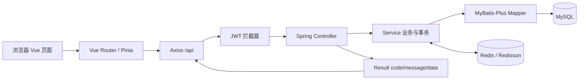

# music-system 项目答辩复习讲解

> 面向答辩前复习。内容按当前项目源码整理，重点讲“用户在页面做了什么，前端发了什么请求，后端哪一层处理，最后哪些数据库记录发生变化”。

## 1. 先用一分钟介绍项目

本项目是一个潮流音乐专辑及衍生品发售系统。用户可以注册登录、浏览专辑和歌曲、管理购物车与收货地址、创建订单、模拟支付、查询物流、申请退款，也可以购买音乐盲盒。管理员可以维护专辑、歌曲、盲盒和用户，处理发货、退款审核并查询操作审计记录。

项目采用前后端分离：前端是 Vue 3 + Vite，后端是 Java 17 + Spring Boot 4.0.8，MyBatis-Plus 负责访问 MySQL，Redis 与 Redisson 负责库存辅助和分布式锁。接口统一返回 `code/message/data`，用户通过 JWT 登录认证。模拟支付用于本地演示，不代表真实资金交易。

答辩时可以补一句：项目不只实现页面，还把订单状态、库存、支付、盲盒抽取、退款和权限校验放在后端服务层控制，避免仅靠前端按钮决定业务结果。

## 2. 技术结构与请求链路

| 层次 | 技术/目录 | 主要作用 |
|---|---|---|
| 前端 | Vue 3、Composition API、Vite | 页面和交互，开发端口 5173 |
| 前端路由 | Vue Router | 登录、商品、订单和管理页面切换及路由守卫 |
| 前端状态 | Pinia | 当前用户、登录状态、音乐播放器状态 |
| 前端请求 | Axios | 统一带 JWT、处理统一响应、处理 401/403 和错误提示 |
| UI | Element Plus、CSS | 表单、表格、分页、弹窗和响应式界面 |
| 后端接口 | Spring Boot 4.0.8、Spring MVC | 默认端口 8080，接收 `/api/**` 请求 |
| 业务层 | Controller、Service | Controller 做 HTTP/身份入口，Service 实现业务规则和事务 |
| 数据访问 | MyBatis-Plus Mapper | 把实体与 MySQL 表对应，执行分页、条件查询和更新 |
| 数据库 | MySQL 8 | 持久化用户、专辑、订单、支付、盲盒等业务数据 |
| 并发辅助 | Redis、Redisson | 缓存库存计数并提供跨进程互斥锁 |



一个典型请求是：用户点击“创建盲盒订单” → `BlindboxView.vue` 调用 `api/blindbox.js` → Axios 添加 `Authorization: Bearer ...` → `JwtInterceptor` 验证 Token 并把 `userId/role` 放入请求上下文 → `BlindBoxController` 取当前用户 → `BlindBoxServiceImpl` 校验与执行业务 → Mapper 写 MySQL → Controller 返回 `Result` → Axios 解包 `data` → 页面跳到订单详情。

## 3. 前端从哪里看

### 3.1 入口与目录

- `frontend/src/main.js`：创建 Vue 应用，安装 Pinia 和 Vue Router，并引入全局 CSS。
- `frontend/src/App.vue`：根视图，同时挂载全局音乐播放器。
- `frontend/src/router/index.js`：定义所有用户端与管理端路由，以及登录/管理员守卫。
- `frontend/src/stores/user.js`：保存当前用户和 Token。Token 只有在登录接口返回 `token` 与 `userInfo` 后才写入 `sessionStorage`。
- `frontend/src/api/request.js`：Axios 实例，统一以 `/api` 为前缀，自动加 Bearer Token，并解析 `{code,message,data}`。
- `frontend/src/api/`：按认证、专辑、购物车、订单、用户、盲盒、管理拆分接口调用。
- `frontend/src/layouts/`：用户端主布局和后台侧边栏布局。
- `frontend/src/views/`：登录、注册、首页、专辑、购物车、地址、订单、退款、盲盒和管理页面。

### 3.2 用户端的页面操作

| 用户动作 | 页面/前端模块 | 后端主要接口 |
|---|---|---|
| 登录、注册 | `views/auth/`、`stores/user.js` | `POST /api/user/login`、`POST /api/user/register` |
| 搜索和浏览专辑 | `HomeView.vue`、`AlbumCard.vue` | `GET /api/album/list` |
| 查看专辑和曲目 | `AlbumDetailView.vue` | `GET /api/album/{id}` |
| 购物车 | `CartView.vue` | `/api/cart/**` |
| 地址 | `AddressView.vue` | `/api/address/**` |
| 创建/查看订单 | `CartView.vue`、`OrderListView.vue`、`OrderDetailView.vue` | `/api/order/**` |
| 支付 | 订单详情页 | `/api/payment/create`、`/api/payment/mock-pay/{paymentNo}`、`/api/payment/query/{paymentNo}` |
| 退款 | 订单详情、退款页 | `/api/refund/apply`、`/api/refund/my` |
| 盲盒 | `BlindboxView.vue` | `/api/blind-box/list`、`/{boxId}`、`/order`、`/my/records` |

Axios 会把后端统一响应中的 `data` 返回给页面；若业务 `code` 不是 200，则显示服务端错误。401 会清除本地登录状态并跳回登录页。前端路由守卫用于改善体验，但不是安全边界；后端仍独立验证 JWT 和角色。

### 3.3 管理端

后台路由包括 `/admin`、`/admin/albums`、`/admin/songs`、`/admin/blindboxes`、`/admin/users`、`/admin/orders`、`/admin/audit-logs`。页面提供列表、查询、分页、编辑表单、上传和状态操作。后端 Controller 还会检查 `admin`/`super_admin`；用户角色修改仅允许超级管理员。前端隐藏或显示菜单不能替代后端校验。

## 4. 后端结构怎么讲

- `controller/`：接收 HTTP 路径、参数和 Token 上下文，调用 Service，再把结果包装为 `Result`。比如盲盒入口在 `BlindBoxController`。
- `service/` 与 `service/impl/`：核心业务所在。库存判断、状态迁移、事务、退款和抽奖都在这里，而不是写在 Vue 页面里。
- `dto/`：请求数据对象，配合 `@Validated`、`@Valid`、字段约束校验参数。
- `entity/`：MyBatis-Plus 实体，对应数据库表。
- `mapper/`：数据访问接口；自定义 SQL 可放在 Mapper 或 XML。
- `vo/`：返回给前端的展示数据，避免直接暴露所有数据库字段。
- `common/result/Result.java`：统一成功/失败响应。
- `common/exception/GlobalExceptionHandler.java`：把业务异常和参数异常转换为统一错误响应。
- `config/JwtInterceptor.java`：解析 JWT、设置请求中的 `userId`、`username`、`role`，并记录管理员操作审计。
- `config/MyBatisPlusConfig.java`：配置 MySQL 分页、下划线转驼峰、SQL 日志和创建/更新时间自动填充。
- `task/OrderTimeoutTask.java`：每分钟扫描到期未支付订单，并通过取消流程回补库存。

`WebConfig` 当前拦截 `/api/**`。注册、登录、测试接口和支付宝通知回调被排除；因此当前专辑目录接口也需要登录。答辩若被问到“游客为什么看不到列表”，应按当前拦截器配置如实回答，不要说成匿名接口。

## 5. 盲盒抽取：这是最值得讲清楚的流程

### 5.1 前端按钮并不直接抽奖

盲盒页先调用：

1. `GET /api/blind-box/list` 获取上架盲盒。
2. 点击详情后调用 `GET /api/blind-box/{boxId}`，查看盲盒和奖品配置。
3. 用户选择单抽/十连抽并选择自己的收货地址。
4. 点击“创建待支付订单”，前端 `BlindboxView.vue` 的 `buy()` 调用 `POST /api/blind-box/order`，请求体主要包含 `boxId、drawCount、addressId`。
5. 前端跳转到订单详情，用户支付；支付成功后再查看 `/api/blind-box/my/records`。

**关键答辩点：前端没有把奖品随机出来，也没有直接把“中奖结果”写进页面。前端只创建待支付订单，真正抽奖在支付成功后由后端完成。** 当前 `BlindBoxController` 没有暴露独立的用户直接抽奖 HTTP 路由；虽然 Service 中保留了内部 `draw(...)` 方法，当前购买流程用的是“创建盲盒订单 → 支付成功 → `drawForOrder(...)`”。

### 5.2 后端抽奖与库存的完整顺序

1. `BlindBoxController.buyBlindBox()` 从拦截器上下文取得 `userId`，将 DTO 交给 `BlindBoxServiceImpl.createBlindBoxOrder()`。
2. Service 校验抽数只能是 1 或 10、盲盒存在且上架、剩余库存足够、地址存在且属于当前用户。
3. Redisson 获取“用户 + 盲盒”维度的分布式锁；Redis 先预扣库存，MySQL 再通过条件更新原子扣减 `remain_count`。数据库更新条件保证库存必须足够，防止多个请求同时把库存扣成负数。
4. 创建 `order_info` 待支付记录：`order_type=2` 标记盲盒订单，保存 `blind_box_id`、`draw_count`、金额、15 分钟过期时间和收货地址快照。此时**已预留库存，但还没有抽奖记录**。
5. 支付成功时，`PaymentServiceImpl` 更新支付单并调用 `OrderServiceImpl.handlePaymentSuccess()`。订单只允许条件更新 `UNPAID(0) → PAID(1)`；重复回调更新不到待支付订单时直接返回，避免重复抽奖。
6. `handlePaymentSuccess()` 发现 `order_type=2`，调用 `BlindBoxServiceImpl.drawForOrder(order)`。它使用抽取锁并读取奖品配置，但传入 `deductStock=false`，因为创建订单时已预扣，避免重复扣库存。
7. 每次抽取生成并保存 `draw_record`，记录奖品、抽取时概率快照、抽取序号和是否保底；更新 `user_draw_stat`；订单保存抽取摘要。1 抽生成 1 条记录，10 连抽最多生成 10 条。
8. 如果抽取失败，支付处理在同一业务链内执行自动退款状态处理并回补预留盲盒库存，避免“扣了钱却没有抽奖结果”。未支付订单被用户取消或定时过期也会走库存回补。
9. Vue 页面再请求 `GET /api/blind-box/my/records` 展示记录。页面展示的是后端写入的数据，不是前端随机数。

### 5.3 概率、保底与并发

- 抽奖实现位于 `BlindBoxServiceImpl.drawOnce()` 和 `drawByProbability()`。
- 普通抽取使用 `SecureRandom` 生成随机值，再按奖品概率累计区间做轮盘赌选择；概率配置保存在 `blind_box_prize`。
- 稀有度等级在代码中为 SSR=1、SR=2、R=3、N=4。
- 用户盲盒统计中分别维护 SSR、SR 连续未中的计数：10 抽触发 SR 保底，30 抽触发 SSR 保底；抽到 SR 重置 SR 计数，抽到 SSR 同时重置 SR/SSR 计数。
- `@Transactional(rollbackFor = Exception.class)` 保证数据库内相关写入出现异常时回滚；Redisson 锁用于跨进程互斥；Redis 计数和 MySQL 条件更新承担不同层的库存保护职责。

## 6. 普通购物、订单与支付

### 6.1 下单

专辑可以是 `PHYSICAL` 实物或 `DIGITAL` 数字商品。实物下单必须提供地址，后端还会验证地址属于当前用户；数字商品不需要地址。订单保存专辑名称、封面、单价、数量、商品形态和收货地址快照，避免商品或地址之后被修改时历史订单跟着变。

直购和购物车结算在 `OrderServiceImpl` 内执行。下单过程会获取专辑锁，先扣 Redis，再用 MySQL 条件更新扣减库存并增加销量，写入 `stock_log`，最后写订单和 `order_item`。多商品订单用 `order_item` 保留每一项的名称、封面、价格、数量和商品形态快照。前端当前购物车页面是逐件结算，页面也明确说明暂不支持一键合并批量结算。

### 6.2 订单状态

当前状态常量在 `OrderStatus.java`：

| 值 | 状态 | 典型流转 |
|---:|---|---|
| 0 | 待支付 | 创建订单后 |
| 1 | 已支付 | 支付成功 |
| 4 | 已发货 | 管理员填写承运商和物流单号 |
| 2 | 已完成 | 用户确认收货 |
| 3 | 已取消 | 用户取消或超时关闭 |
| 5 | 已退款 | 退款执行完成 |

主流程：`0 → 1 → 4 → 2`；未支付订单可从 `0 → 3`；符合条件的已支付/已发货订单可退款到 `5`。接口用带旧状态条件的 SQL 更新状态，状态已被其他请求改变时不会再次推进。

### 6.3 支付

前端点击支付调用 `POST /api/payment/create`。开发配置 `pay.mock-enabled=true` 时，后端返回支付单号，前端调用 `POST /api/payment/mock-pay/{paymentNo}`，再查支付结果。模拟支付只更新本地业务状态，不产生真实资金交易。接入支付宝时由 SDK 创建支付链接，服务端通知通过验签后走相同的支付成功处理逻辑；异步通知接口免 JWT，但不等于免签名验证。

支付状态是另一套常量：待支付 0、成功 1、失败/关闭 2、已退款 3。支付单和订单分开存储，支付单对应流水和渠道交易号，订单记录商品与履约状态。

### 6.4 超时与物流

订单创建后设置 15 分钟过期时间。`OrderTimeoutTask` 每分钟扫描过期的待支付订单，通过订单取消逻辑回补库存。管理员发货时写 `order_logistics` 并把订单从已支付改为已发货；只有订单本人可确认收货，且状态必须为已发货。订单详情再把物流信息返回前端。

### 6.5 数字内容交付

数字内容地址放在专辑配置中，不在公开专辑 VO 中直接发给所有用户。用户必须有本人已支付的数字商品订单才能请求数字内容接口；首次访问会记录取阅时间。退款策略会检查这个时间：已交付的数字内容不能在线申请退款。多明细订单还有 `order_item.digital_content_accessed_at` 明细级记录。

## 7. 退款逻辑

退款不是只把页面状态改成“退款成功”。

1. 用户提交 `POST /api/refund/apply`，Service 查询本人订单并锁定订单行。
2. `RefundPolicy` 判断商品形态和订单状态：数字商品仅已支付且未取阅可申请；实物已支付或已发货可申请；已发货实物必须补充退货承运商和单号。
3. 拒绝重复存在的待处理/已通过申请，创建 `refund_application` 待审核记录。
4. 管理员通过 `PUT /api/refund/admin/{applicationId}/review` 审核。拒绝只更新申请状态，不改变订单、支付或库存；批准则条件更新申请、订单、支付单，并根据订单数量回补库存、记录库存流水。
5. 真正支付宝支付的订单会调用支付宝退款；模拟支付只推进本地模拟状态。任一步失败抛异常并由事务回滚，避免申请显示已退款但订单或支付仍处于成功状态。

## 8. 数据库怎么介绍

当前核心表及关系可以这样讲：

| 表 | 用途/关系 |
|---|---|
| `sys_user` | 用户、密码哈希和角色 |
| `album`、`song` | 专辑和歌曲；歌曲通过 `album_id` 关联专辑 |
| `shopping_cart` | 用户选择的专辑及数量 |
| `user_address` | 用户收货地址；下单时另存地址快照 |
| `order_info` | 订单头；保存用户、状态、金额、商品类型、地址快照及盲盒订单扩展字段 |
| `order_item` | 订单明细及下单时商品快照 |
| `payment` | 支付流水和支付状态 |
| `order_logistics` | 订单物流公司、单号和发货时间 |
| `refund_application` | 用户申请、审核人、审核状态和退款信息 |
| `blind_box`、`blind_box_prize` | 盲盒和奖品概率配置 |
| `draw_record`、`user_draw_stat` | 每次抽取审计记录及用户保底计数 |
| `stock_log` | 库存变化流水 |
| `admin_audit_log` | 管理员接口访问审计 |

部分老订单结构沿用 `order_info` 的专辑字段；盲盒订单通过 `order_type=2`、`blind_box_id` 和 `draw_count` 区分。展示时不要只看旧的 `album_id` 字段就判断这一定是普通专辑订单。

数据库初始化文件是 `sql/music_system.sql`；增量结构和数据调整使用 `sql/` 下日期迁移脚本。答辩演示应使用本地/测试库，不要直接在生产数据上运行初始化脚本。

## 9. 安全、异常和审计

- 登录成功后由后端签发 JWT；前端保存在 `sessionStorage`，Axios 统一加 Bearer Token。
- `JwtInterceptor` 验证签名与过期时间，并把用户 ID、用户名、角色放到请求属性。
- Controller 仍对管理员 API 检查角色；多数后台操作要求 `admin` 或 `super_admin`，修改用户角色只允许 `super_admin`。
- 用户只能查自己的订单、地址、购物车、退款和抽取记录。订单号不能代替归属校验。
- MyBatis-Plus 的逻辑删除避免普通业务删除直接清除记录；关键状态更新采用条件 SQL。
- `GlobalExceptionHandler` 把 `BusinessException`、参数校验等转换成统一响应，前端按业务码显示提示。
- `JwtInterceptor.afterCompletion()` 对管理员接口、发货、退款管理等记录操作人、角色、HTTP 方法、路径、HTTP 状态和客户端地址；审计查询自身不重复记日志。写日志失败会记录错误日志，不把已完成的管理员业务反向变成失败。

## 10. 文件上传与歌曲播放的现状

图片和音频由管理员媒体接口上传到本地 `uploads/`，经 `/media/**` 映射访问。数据库保存相对 URL，而不是二进制文件本身。

音乐播放器已经有 Pinia 状态和全局 Audio 组件；专辑详情只对用户公开 `SongVO.previewUrl`，正式音源 `audioUrl` 不直接公开，避免绕过数字内容购买权限。但当前数据库 10 首歌曲中，5 首试听地址是 `example.com` 示例链接，另外 5 首为空；项目没有真实音频文件，因此**当前实际可播放歌曲数为 0/10**。答辩时不要说“已接入真实歌曲播放成功”。可以解释播放器交互已完成，真实播放需要先上传拥有使用权的试听文件并给歌曲设置 `previewUrl`。

## 11. 当前验收状态与演示边界

- 前端 `npm run build` 已通过；之前用户流程、后台操作、媒体上传及图片等 Playwright 测试有通过记录。最新音频/商品图片专项为 2 passed、1 skipped；后台图片表用例因本地管理员凭据文件不可用而跳过。
- 项目支持模拟支付闭环；这不是支付宝真实收款。支付宝沙箱或生产交易还依赖商户密钥、回调公网地址、证书和平台配置。
- 当前前端首页接口也受 JWT 拦截，答辩前应先登录。
- 盲盒必须先创建待支付订单再支付，支付成功后自动抽奖；不是前端点击就立即抽出奖品。
- 一些 QA 账号、订单和测试数据会保留在开发库中，答辩应挑选标识清晰的数据演示。

## 12. 建议的答辩演示顺序

1. 登录普通用户，展示首页专辑分页、关键词搜索和专辑详情。
2. 展示购物车、地址，并解释后端为什么重新校验地址归属和库存。
3. 创建订单，展示待支付状态和订单地址快照。
4. 用模拟支付完成付款，展示订单状态变化；明确说明是开发模拟，不是真实交易。
5. 如果有管理员账号，切换后台演示专辑/盲盒配置、发货和审计记录。
6. 演示盲盒时强调：下单预留库存、支付成功后后端抽取、抽奖记录可查询、重复回调不会重复抽取。
7. 介绍退款规则和数字内容取阅后的退款限制。
8. 最后说明已知边界：真实音频文件尚未提供，模拟支付不代表真实商户交易。

## 13. 老师常问的问题与参考回答

### Q1：为什么抽奖不能放在前端？

因为浏览器代码可以被修改，用户能伪造请求或篡改随机结果。奖品概率、保底、库存和结果落库都在后端 Service；前端只展示后端结果。

### Q2：如何避免同一个盲盒超卖？

先通过 Redis 预扣并用 Redisson 对用户和盲盒加分布式锁，再用 MySQL `remain_count >= drawCount` 的条件更新兜底。Redis 不能替代数据库最终约束，两层都成功才继续创建订单；失败会回补 Redis/库存。

### Q3：支付回调重复到达怎么办？

订单更新使用 `WHERE status=UNPAID` 的条件更新。只有一次请求能将状态从待支付改为已支付；其他回调更新行数为 0 后直接返回，所以不会重复抽奖。

### Q4：抽奖结果保存在哪里？

每抽一条 `draw_record`，保存用户、盲盒、奖品、抽中时概率、抽数序号和保底标识；累计次数与保底计数保存在 `user_draw_stat`；订单摘要保存在 `order_info.draw_summary`。

### Q5：数据库事务和 Redis 锁分别解决什么问题？

事务保证 MySQL 内订单、支付、抽奖记录等多表写入一起提交或回滚；Redisson 锁控制多个应用实例之间同一业务资源的并发进入。锁不等于事务，事务也不等于分布式锁。

### Q6：前端隐藏管理员按钮是不是权限控制？

不是。前端路由守卫和隐藏菜单只改善体验。真正授权由后端 JWT 拦截器和 Controller 角色检查完成，直接用普通用户 Token 请求管理员接口仍会被拒绝。

### Q7：为什么要保存地址和商品快照？

订单需要反映下单当时的商品名称、价格、数量、形态、封面和收货信息。后续修改地址或商品目录不能改变历史订单凭证。

### Q8：当前歌曲是不是已经可以真实播放？

播放器组件和交互已经实现，但本地音频数据目前不可用：5 条试听 URL 是示例域名并返回 404，5 条为空，音频文件数量为 0。因此目前不能承诺真实播放；需要先配置有授权的试听文件。

## 14. 现场启动命令

先确认 MySQL 3307、Redis 6379 已启动。后端和前端分别开两个 PowerShell 窗口：

```powershell
# 窗口一：后端
cd D:\IntelliJ\music-system
mvn -s "$env:USERPROFILE\.m2\settings.xml" spring-boot:run

# 窗口二：Vue 前端
cd D:\IntelliJ\music-system\frontend
npm run dev
```

浏览器访问 `http://localhost:5173`。本地构建与指定浏览器测试：

```powershell
cd D:\IntelliJ\music-system\frontend
npm run build
npm run test:e2e -- --workers=1
```

全流程 E2E 会创建 QA 账号/订单等测试数据并保留，不要在正式库上运行。演示时不展示密码、JWT、支付宝私钥或数据库凭据。
